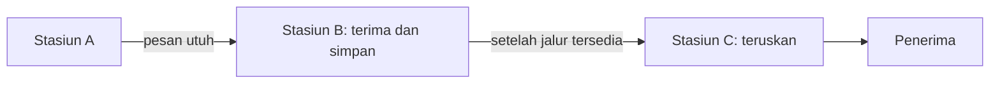
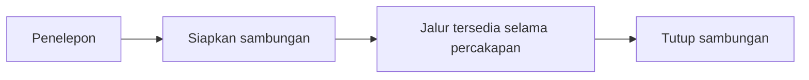
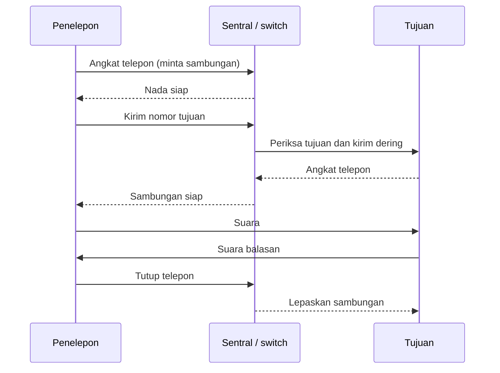
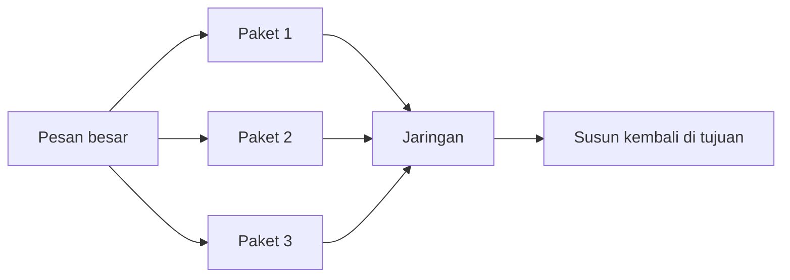
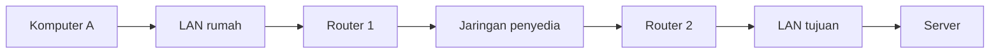
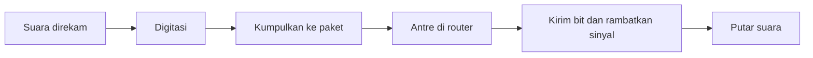
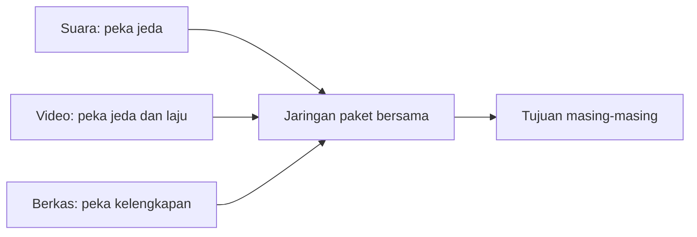
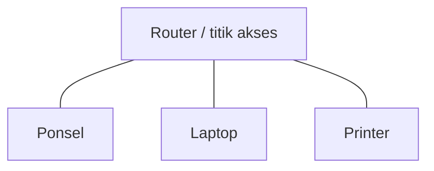

# Bab 1 — Jaringan Komunikasi dan Layanan

> Pertanyaan utama: mengapa jaringan telegraf, telepon, dan Internet memakai rancangan yang berbeda?

Susunan 1.1–1.3 dan nomor subbagiannya mengikuti Bab 1 buku Leon-Garcia dan Widjaja, edisi kedua. Penjelasan memakai bahasa sendiri berdasarkan **isi Bab 1 buku** dan **63 slide kuliah Bab 1**. Contoh masa kini diberi konteks tersendiri agar tidak tertukar dengan teknologi yang dijelaskan buku terbitan 2004. Baca berurutan: kebutuhan layanan → cara kerja → alasan rancangan → istilah.

**Peta cepat.** Bagian 1.1 membandingkan telegraf, telepon, jaringan komputer, dan Internet. Bagian 1.2 bertanya bagaimana suara, video, dan data hidup dalam satu jaringan. Bagian 1.3 membahas mengapa teknologi yang bagus pun belum tentu berhasil dipakai luas.

## 1.1 Evolusi Arsitektur dan Layanan Jaringan (*Evolution of Network Architecture and Services*)

Sensei menekan tombol kirim pada ponsel. Pesan itu tidak langsung “melompat” ke ponsel teman. Ponsel mengubah isi pesan menjadi data, jaringan membawanya melalui beberapa perangkat dan sambungan, lalu ponsel teman menampilkannya kembali.


*Jaringan komunikasi* adalah gabungan perangkat dan sarana yang memungkinkan informasi berpindah antarpengguna di tempat berbeda. Perangkatnya bisa berupa ponsel, komputer, *switch*, dan *router*. Sarananya bisa berupa gelombang radio, kabel tembaga, atau serat optik.

Tidak semua langkah di diagram harus terjadi secara langsung. Pada aplikasi pesan, layanan aplikasi dan koneksi Internet bisa melibatkan beberapa jaringan serta komputer perantara.

### Empat istilah yang sering tertukar

| Istilah | Pertanyaan yang dijawab | Contoh |
|---|---|---|
| **Aplikasi** | “Apa yang ingin dilakukan pengguna?” | Mengirim pesan, membuka web, menelepon |
| **Layanan komunikasi** | “Kemampuan pemindahan informasi apa yang tersedia?” | Mengirim data antarkomputer; membawa suara secara langsung |
| **Jaringan** | “Perangkat dan sambungan apa yang menyediakan kemampuan itu?” | Jaringan seluler, jaringan kampus, Internet |
| **Arsitektur jaringan** | “Bagaimana bagian jaringan disusun dan bekerja sama?” | Aturan alamat, cara meneruskan data, dan pembagian tugas antarbagian |

**Ingat:** aplikasi *memakai* layanan; jaringan *menyediakan* layanan. Kebutuhan layanan ikut menentukan arsitektur jaringan.

### Contoh aplikasi dan layanan dalam slide

| Aplikasi | Apa yang pengguna lakukan? | Layanan dasar yang diperlukan |
|---|---|---|
| Membuka web | Peramban meminta halaman dari server web | Pertukaran data yang utuh dan berurutan |
| Surat elektronik dan pemindahan berkas | Mengirim isi yang harus lengkap | Aliran data andal (*reliable byte stream*) |
| Suara lewat Internet (*VoIP*) atau permainan jaringan | Berinteraksi dengan orang lain saat itu juga | Pertukaran data dengan jeda kecil; data yang sangat terlambat bisa tidak berguna |
| Video atau audio *streaming* | Memutar media sambil menerima bagian berikutnya | Laju data yang cukup dan keterlambatan yang terkendali |
| SMS pada contoh historis slide | Mengirim teks dari layanan seluler | Dapat memakai lebih dari satu jaringan atau layanan dasar |
| Berbagi berkas *peer-to-peer* (P2P) | Dua komputer saling berbagi sumber daya | Pertukaran data antarkomputer, kadang tanpa satu server pusat untuk semua berkas |

Slide menyebut Napster, Gnutella, Kazaa, SETI, dan PDA sebagai contoh **sezamannya**, bukan daftar aplikasi yang harus dipakai sekarang. *Layanan dasar* tidak sama dengan aplikasinya: HTTP adalah aturan aplikasi web; layanan pemindahan data di bawahnya memungkinkan aturan itu bekerja. Bab 2 membahas lapisan ini lebih rinci.

Jaringan memuat **peralatan** (*equipment*) seperti *router*, *switch*, server, *hub*, modem, dan *multiplexer*, serta **sarana** (*facilities*) seperti kabel tembaga, kabel koaksial, serat optik, saluran kabel, dan tiang. Gambar “awan jaringan” di slide menyembunyikan banyak bagian itu agar alur antarpengguna mudah dilihat.

### Mengapa ada *switch*, *multiplexer*, dan hierarki?

*Switch* menghubungkan masukan ke keluaran yang sesuai. Dua pekerjaannya berbeda: **routing** menentukan keluaran/arah; **forwarding** memindahkan informasi ke keluaran itu. *Multiplexer* menggabungkan lalu lintas beberapa sumber ke satu jalur bersama, sering disebut *trunk* ketika menghubungkan dua perangkat jaringan. Contoh: empat kantor cabang tidak selalu perlu empat kabel jarak jauh tersendiri; arusnya dapat digabung pada satu jalur yang cukup besar. Jika arus datang bersamaan lebih cepat daripada kemampuan jalur, sebagian harus menunggu.

Dalam **topologi hierarkis**, perangkat dekat pengguna terhubung ke pusat setempat, lalu pusat setempat ke tingkat lebih tinggi. Ini mengurangi kebutuhan sambungan langsung untuk setiap pasangan pengguna. Kekurangannya, bagian pusat menjadi penting: kapasitas dan ketahanannya harus dirancang dengan baik. Bandingkan dengan **topologi jejaring (*mesh*)**: ada beberapa jalur alternatif, tetapi pemilihan rutenya lebih rumit.

Kebutuhan aplikasi menentukan layanan yang harus disediakan. Pesan teks dapat menunggu sebentar; percakapan suara lebih peka terhadap jeda. Dari sini muncul tiga rancangan historis berikut.

### 1.1.1 Jaringan telegraf dan *message switching*

Telegraf membawa teks. Pesan diberi tujuan, diterima di sebuah stasiun, disimpan sementara, lalu diteruskan ke stasiun berikutnya. Proses ini disebut **store-and-forward**. Cara memindahkan pesan utuh antarstasiun disebut **message switching**.



**Kelebihan:** tidak perlu menyediakan jalur khusus dari awal sampai akhir. **Kendala:** pesan panjang dapat menahan pesan lain; setiap stasiun mungkin harus menunggu sampai pesan diterima lengkap. Konsep alamat, rute, dan penerusan dari telegraf masih penting pada jaringan modern.

#### Mekanisme telegraf, dari huruf sampai tujuan

1. Operator mengubah huruf menjadi lambang. Pada telegraf Morse, titik dan garis diwujudkan dengan pulsa listrik pendek dan panjang. Ini bentuk awal **transmisi digital**: dipakai lambang yang dapat dibedakan, walau belum sama dengan pengkodean biner komputer modern.
2. Penerima harus tahu di mana suatu huruf dan pesan dimulai atau berakhir. Aturan pembatas ini disebut **framing**. Tanpanya, rangkaian lambang sulit dipecah kembali menjadi informasi yang bermakna.
3. Pesan memuat **alamat tujuan**. Stasiun perantara membaca alamat, memilih stasiun berikutnya (**routing**), lalu mengirim ke sana (**forwarding**).
4. Bila jalur keluar masih dipakai, stasiun **menyimpan** pesan utuh dan **menunggu**. Setelah jalur bebas, pesan diteruskan. Inilah alasan namanya *store-and-forward*.

**Contoh kecil:** A mengirim dua pesan ke C lewat B. Pesan pertama panjang dan belum selesai diterima B; pesan kedua yang pendek dapat tertahan walau C hanya memerlukan pesan pendek itu. Keterlambatan seperti ini menjadi salah satu alasan kelak dipakai paket berukuran terbatas.

**Multiplexing** berarti beberapa sumber berbagi satu jalur. Sistem Baudot mengkodekan karakter dalam lima bit dan menyisipkan karakter dari beberapa operator secara bergantian. Dari gagasan pengkodean karakter berkembang kode lain seperti ASCII. Cara lain memakai **modulasi**: sinyal digital diwakili oleh nada/frekuensi tertentu, lalu beberapa kanal dapat dibawa bersama; prinsip ini berkaitan dengan *modem* (*modulator–demodulator*). Jangan samakan *multiplexing* dengan *switching*: yang pertama berbagi jalur, yang kedua memilih sambungan atau keluaran.

### 1.1.2 Jaringan telepon dan *circuit switching*

Percakapan membutuhkan aliran suara dua arah dengan jeda kecil. Jaringan telepon tradisional memakai **circuit switching**: sebelum berbicara, jaringan menyiapkan sambungan dan menyediakan sumber daya pada jalur tersebut selama panggilan.



Analogi sederhana: seperti memesan satu ruang untuk percakapan. Selama dipesan, ruang itu siap dipakai meskipun kedua orang sedang diam. Ini membantu menjaga kelangsungan percakapan, tetapi sumber daya yang dipesan bisa menganggur.

#### Mengapa telepon perlu sentral?

Suara menimbulkan perubahan tekanan udara. **Mikrofon** mengubahnya menjadi sinyal listrik yang bentuknya mengikuti suara (**analog**); **pengeras suara** mengubahnya kembali menjadi suara. Karena percakapan berlangsung dua arah dan langsung, jaringan perlu menyediakan jalan bicara yang siap dipakai.

Jika setiap pasangan dari `N` pelanggan dihubungkan dengan kabel sendiri, jumlah kabelnya `N(N−1)/2`: pelanggan pertama perlu `N−1` sambungan, tetapi tiap pasangan terhitung dua kali bila semua pelanggan dijumlahkan. Untuk `N = 4`, diperlukan `4×3/2 = 6` kabel; untuk `N = 1.000`, diperlukan **499.500**. Buku di satu kalimat mencetak 495.000, sedangkan rumus dan slide menghasilkan 499.500. Dengan satu **sentral telepon** (*central office*, CO), tiap pelanggan cukup mempunyai sambungan ke sentral setempat; sentral menyambungkan pasangan yang sedang menelepon. Ini mengurangi jumlah kabel pelanggan, tetapi sentral dan jalur antarsentral tetap perlu kapasitas.

#### Ikuti satu panggilan tradisional



Tiga fase utamanya adalah **setup** (nomor, pilih rute, siapkan sambungan), **transfer** (suara mengalir), lalu **release/tear-down** (jalur dilepas). **Signaling** ialah pesan kendali untuk membunyikan, memilih rute, atau mengakhiri panggilan; ia berbeda dari sinyal suara yang menjadi isi percakapan. Tujuan sibuk dapat membuat setup gagal. Setelah sirkuit siap, suara tidak perlu membawa alamat tujuan pada setiap potongan sinyal; keputusan rute sudah dibuat ketika setup.

Awalnya operator menyambung kabel pada **patch panel** secara manual. **Strowger switch** kemudian memakai pulsa dari nomor yang diputar untuk menggerakkan pemilih otomatis. Nomor telepon yang tersusun bertingkat membantu menentukan tujuan: wilayah → sentral → saluran pelanggan. Pelanggan tersambung ke **CO**, beberapa CO dapat dihubungkan oleh **tandem switch**, dan sambungan lebih jauh memakai tingkat antarkota (*toll*). Jadi hierarki mempermudah routing dan perluasan jaringan.

#### Dari suara analog ke jaringan telepon digital

**Pulse Code Modulation (PCM)** mengambil sampel suara dan menyatakannya sebagai angka. Contoh pada slide: `8.000 sampel/detik × 8 bit/sampel = 64.000 bit/detik = 64 kbps` untuk satu kanal suara. **Time Division Multiplexing (TDM)** memberi giliran waktu pada beberapa kanal yang berbagi jalur. Contoh historis T1 membawa 24 kanal suara dengan laju jalur 1,544 Mbps; `24 × 64 kbps = 1,536 Mbps`, dan sisa 8 kbps dipakai untuk framing. Nilai itu contoh sistem tertentu, bukan aturan bahwa setiap suara digital selalu 64 kbps.

Ketika **digital switching** hadir, sentral dapat meneruskan suara dalam bentuk digital tanpa bolak-balik mengubahnya menjadi analog di setiap sentral. Pada **telepon seluler**, pengguna dapat berpindah dari cakupan satu antena ke antena lain; pertukaran pesan kendali mengoordinasikan **handoff/handover** agar panggilan berlanjut. Ini contoh peran jaringan signaling, bukan fungsi suara itu sendiri.

Arsitektur telepon karena itu memerlukan transmisi suara, *switch*, penomoran, signaling pengguna-ke-jaringan, serta signaling di dalam jaringan untuk memilih dan menyiapkan rute. Istilah **connection-oriented** berarti jalur/keadaan sambungan dibuat sebelum isi percakapan lewat. Namun hubungan logis yang dibuat protokol komputer tidak otomatis berarti sirkuit telepon fisik.

### 1.1.3 Internet, jaringan komputer, dan *packet switching*

Komputer mengirim banyak jenis data: pesan singkat, halaman web, berkas besar, serta suara atau video. Dalam **packet switching**, pesan besar dipecah menjadi unit kecil yang disebut **paket**. Paket dapat berbagi jalur dengan paket dari pengguna lain.



**Kelebihan:** jalur dapat dibagi secara efisien; paket pendek dari pengguna lain tidak harus menunggu satu pesan panjang selesai seluruhnya. **Kendala:** paket dapat mengantre, hilang, atau tiba tidak berurutan. Protokol di bagian jaringan dan ujung komunikasi menangani kebutuhan seperti ini.

#### Sebelum Internet: terminal dan satu komputer besar

Komputer awal mahal, sehingga banyak **terminal** (alat masukan/tampilan sederhana) memakai satu **host**. Contoh historis dalam buku ialah SAGE dan sistem reservasi penerbangan SABRE. Terminal dapat terhubung lewat kabel langsung atau **modem** di atas jaringan telepon. Susunannya sering **pohon**: banyak terminal menuju satu host. Routing mudah karena pesan hampir selalu menuju host lalu kembali, tetapi sistem kurang luwes ketika tiap komputer perlu berhubungan dengan banyak komputer lain.

Ketika terminal berbagi satu kabel (*multidrop line*), dua terminal yang mengirim serentak dapat bertabrakan. **Medium Access Control (MAC)** mengatur siapa boleh mengirim. Dalam contoh **polling**, host bertanya terminal A dahulu, lalu B, lalu C; hanya terminal yang ditanya boleh menjawab. Ini mencegah tabrakan, tetapi giliran yang terlalu banyak dapat menambah waktu tunggu.

**Statistical multiplexer/concentrator** menerima data dari beberapa terminal, menaruhnya di **buffer** (tempat simpan sementara), lalu mengirim satu demi satu ketika jalur bersama tersedia. Sebuah **frame** memuat *header* (alamat dan keterangan kendali), isi (*payload*), serta bit pemeriksa seperti **CRC**. *Framing* menandai batas frame. Penerima menghitung pemeriksa lagi; jika tidak cocok, frame dianggap rusak dan pengiriman ulang dapat diminta. **ACK** berarti diterima, **NAK** berarti ditolak/bermasalah. CRC membantu *mendeteksi* kesalahan; CRC sendiri tidak menjamin semua kesalahan pasti terdeteksi atau otomatis memperbaikinya.

```text
Terminal A ─┐
Terminal B ─┼─> [multiplexer: antrekan] ── satu jalur ──> Host
Terminal C ─┘

Contoh frame: [alamat/kendali | isi data | CRC]
```

#### Dari satu host ke banyak komputer: ARPANET

Ketika komputer menjadi lebih murah, dibutuhkan hubungan **komputer-ke-komputer** untuk surat elektronik, login jarak jauh, dan pemindahan berkas. ARPANET menjadi percobaan besar jaringan paket wilayah luas. Berbeda dari terminal, komputer di tepi jaringan memiliki kemampuan memproses dan menyimpan data; sebagian pekerjaan dapat diletakkan di sana.

**Mengapa pesan dipecah?** Misalkan sebuah jalur mengirim 1.000 bit per detik. Pesan A sepanjang 8.000 bit menahan jalur selama 8 detik bila dikirim utuh. Jika dibagi menjadi delapan paket masing-masing 1.000 bit, paket B yang pendek dapat memperoleh giliran setelah sekitar 1 detik, bukan menunggu seluruh pesan A. Contoh ini mengabaikan *header*, antrean, dan waktu tempuh sinyal agar perbedaan konsep terlihat. Paket mempunyai panjang maksimum; pesan panjang melalui **segmentasi**, lalu **reassembly** di tujuan. Setiap paket membawa *header* tujuan dan dapat diteruskan **store-and-forward** dari satu *packet switch* ke berikutnya.

Dalam contoh ARPANET buku, paket dapat berjalan tanpa setup lebih dahulu (**connectionless**). Tiap *switch* menyimpan **routing table** yang memetakan tujuan ke **next hop**. Perangkat itu menerima paket, membaca tujuan, menaruhnya di buffer bila keluaran sibuk, lalu meneruskan. Perangkat saling bertukar informasi untuk memperbarui rute ketika jalur gagal; karena rute dapat berubah, paket bisa tiba tidak berurutan.

Tiga pengendalian berikut berbeda:

| Kendali | Masalah yang dicegah | Contoh pada kisah ARPANET |
|---|---|---|
| **Error control** | Bit/frame rusak di satu sambungan | Pemeriksaan CRC, pengakuan penerimaan, dan pengiriman ulang antartetangga |
| **Flow control** | Penerima lebih lambat daripada pengirim sehingga buffer penerima penuh | Host pengirim menyesuaikan laju dengan host penerima |
| **Congestion control** | Terlalu banyak paket di tengah jaringan sehingga antrean penuh | Jumlah paket yang sedang berada di jaringan dibatasi atau laju pengirim diturunkan |

Pengendalian kesalahan antarsimpul pada ARPANET adalah contoh **historis**. Jangan menganggap IP modern selalu mengirim ulang setiap paket di tiap router.

#### LAN dan Ethernet: siapa boleh memakai media bersama?

**LAN** (*local area network*) menghubungkan perangkat dalam wilayah terbatas, misalnya gedung, untuk berbagi printer, penyimpanan, dan server. **NIC** (*network interface card*) adalah antarmuka jaringan pada komputer; alamat pada NIC dipakai untuk mengenali penerima frame di LAN. Pada **Ethernet koaksial awal**, semua stasiun memakai satu kabel bus: sebuah frame terlihat oleh stasiun lain, tetapi hanya penerima yang sesuai alamat memprosesnya. Stasiun mendengar apakah kabel kosong (**carrier sense**), mulai mengirim jika kosong, memeriksa apakah terjadi **collision**, lalu menghentikan dan mencoba lagi setelah menunggu bila bertabrakan. Mekanisme ini dikenal sebagai **CSMA/CD**.

```text
Ethernet lama:  A ─── B ─── C ─── D     (satu kabel/media bersama)
Ethernet kini: A ─┐
                  ├── switch ── router  (tautan terpisah ke switch)
               B ─┘
```

Slide dan buku memakai contoh Ethernet koaksial atau *hub* yang berbagi media. Pada Ethernet modern dengan *switch* dan tautan *full-duplex*, frame biasa diteruskan ke port yang sesuai dan collision dengan cara lama tidak terjadi. **Broadcast** tetap ada untuk jenis frame tertentu, tetapi “Ethernet = semua data selalu ke semua komputer” tidak benar untuk jaringan modern.

#### Internet menghubungkan jaringan yang berbeda

**Internetwork** berarti beberapa jaringan berbeda saling dihubungkan. **Router/gateway** berada di perbatasan jaringan dan meneruskan paket IP dari satu jaringan ke jaringan berikutnya. Contohnya ponsel → Wi-Fi rumah → jaringan penyedia → jaringan pusat data. Jaringan di bawahnya boleh memakai teknologi berbeda; **IP** memberi cara bersama untuk membawa **datagram** antarsistem.



Dalam model buku, IP memberikan layanan **best effort**: berusaha mengantar paket, tetapi tidak menjanjikan paket pasti sampai, tepat urutan, atau tiba sebelum batas waktu. Router tidak otomatis memperbaiki semua masalah itu. Jika aplikasi memerlukan aliran data utuh dan berurutan, **TCP** menanganinya pada komputer ujung. **UDP** menyediakan pengiriman blok data tersendiri dengan mekanisme sederhana tanpa jaminan keandalan seperti TCP. Keduanya memakai IP; pilihan aplikasi bergantung pada kebutuhannya. Bab 2 akan menjelaskan lapisan transport lebih jauh.

**Alamat IP** dipakai untuk routing, sedangkan **nama domain** memudahkan manusia. Pada contoh IPv4 buku, `128.100.11.1` terdiri atas 32 bit dan ditulis dalam empat angka desimal; bagian **prefix jaringan** dan bagian host memungkinkan alamat dikelompokkan. Batas bagian itu ditentukan oleh prefix/subnet, jadi **tidak selalu** tepat pada batas titik di notasi angka. **DNS** menerjemahkan nama seperti `contoh.example` menjadi alamat IP. Urutannya saat membuka situs secara sederhana: cari alamat lewat DNS → kirim paket menuju server → aplikasi bertukar permintaan dan jawaban. DNS bukan alamat dan bukan router.

**Protokol** adalah aturan tentang bentuk pesan, urutan pertukaran, dan tindakan bila suatu kejadian terjadi. Contoh: HTTP untuk pertukaran web, SMTP untuk surat elektronik, IP untuk datagram antarsistem, TCP/UDP untuk layanan antaraplikasi. Menyebut “pakai protokol” saja belum menjelaskan mekanismenya: tanyakan *siapa mengirim apa, kapan, dan bagaimana penerima merespons*.

#### Bandingkan ketiganya

| Cara | Yang dipindahkan | Perlu sambungan yang disiapkan dahulu? | Contoh historis | Hal penting |
|---|---|---|---|---|
| **Message switching** | Pesan utuh | Tidak | Telegraf | Simpan, lalu teruskan pesan |
| **Circuit switching** | Aliran melalui jalur yang disediakan | Ya | Telepon tradisional | Sumber daya tersedia selama sambungan |
| **Packet switching** | Potongan data berupa paket | Tidak harus; tergantung jenis layanan | Internet | Paket berbagi jalur dan bisa mengantre |

**Jangan samakan “punya koneksi” pada aplikasi dengan circuit switching.** Koneksi TCP, misalnya, adalah hubungan logis antarujung di atas jaringan yang umumnya mengirim paket; bukan berarti satu sirkuit fisik dipesan sepanjang perjalanan.

#### Sepuluh fungsi yang menyusun arsitektur jaringan komputer

Buku menutup §1.1 dengan daftar fungsi berikut. Baca dari dasar ke atas; fungsi di bawah menyediakan kemampuan bagi fungsi di atas. Pembagian resmi ke lapisan dibahas pada Bab 2.

| Fungsi | Pertanyaan sederhana | Contoh |
|---|---|---|
| 1. Transmisi digital | Bagaimana bit bergerak di media? | Pulsa listrik, cahaya pada serat, atau gelombang radio |
| 2. Framing dan pemeriksaan kesalahan | Di mana satu kiriman antartetangga dimulai dan berakhir; apakah isinya rusak? | Frame dan CRC |
| 3. Kendali akses media | Siapa boleh memakai media bersama saat ini? | Polling; CSMA/CD pada Ethernet lama |
| 4. Pengalamatan | Di mana perangkat/tujuan berada? | Alamat antarmuka LAN dan alamat IP |
| 5. Pemindahan paket | Ke jalur berikutnya mana paket diteruskan? | Router membaca tabel rute |
| 6. Perhitungan rute | Bagaimana tabel rute dibuat saat keadaan berubah? | Router bertukar informasi rute |
| 7. Kendali kemacetan | Bagaimana mencegah jaringan kelebihan beban? | Mengurangi laju saat antrean penuh |
| 8. Antarjaringan | Bagaimana jaringan yang berbeda bisa berkomunikasi? | IP di atas Wi-Fi, Ethernet, dan jaringan lain |
| 9. Segmentasi, penyusunan ulang, dan pemulihan ujung-ke-ujung | Bagaimana pesan besar dan paket yang hilang ditangani? | Membagi pesan, menyusun kembali, mengirim ulang bila layanan memerlukannya |
| 10. Aplikasi | Apa yang akhirnya dilakukan pengguna? | Web, surat elektronik, dan pemindahan berkas |

**Contoh alur utuh:** ketika sebuah komputer mengirim foto, aplikasi menyiapkan data (10), data panjang dibagi menjadi bagian (9), setiap bagian diberi alamat untuk melintasi beberapa jaringan (4 dan 8), router memilih keluaran (5–6), lalu setiap tautan mengirim frame dan bitnya (1–3). Jika jaringan padat, pengiriman dapat diperlambat (7). Di tujuan, bagian yang diperlukan disusun kembali. Fungsi-fungsi itu tidak berarti setiap protokol mengerjakan semuanya sendiri.

#### Empat contoh yang muncul dalam pola soal UTS lama

| Contoh | Pengelompokan yang tepat | Alasannya |
|---|---|---|
| Jaringan telepon tradisional (PSTN) | *Circuit switching* | Sirkuit disiapkan selama panggilan. |
| IP | *Packet switching* jenis *datagram* | Setiap paket dibawa dengan alamat tujuan; jaringan tidak harus menyiapkan jalur tetap sebelumnya. |
| ATM | *Packet switching* jenis *virtual circuit* | Jalur logis disiapkan dahulu, lalu unit data mengikuti identitas jalur tersebut. Ini bukan sirkuit fisik khusus seperti pada telepon tradisional. |
| Ethernet pada contoh LAN lama dengan media bersama | Komunikasi *broadcast* pada satu media | Beberapa perangkat berbagi media; satu transmisi dapat terlihat oleh perangkat lain pada media itu. Ethernet modern yang memakai *switch* tidak berarti semua lalu lintasnya disiarkan ke seluruh LAN. |

*Datagram* dan *virtual circuit* sama-sama cara membawa unit data melalui jaringan paket. Pembeda utamanya: datagram tidak mensyaratkan pembentukan jalur logis lebih dahulu, sedangkan *virtual circuit* mensyaratkannya. Ini membantu membaca pilihan jawaban pada UTS lama tanpa menyamakan *virtual circuit* dengan *circuit switching*.

#### Ikuti satu pesan sampai tujuan

1. Aplikasi membaca foto dan menyiapkan data untuk dikirim.
2. Data dibagi menjadi bagian-bagian yang dapat dibawa melalui jaringan.
3. Bagian-bagian itu dikirim sebagai paket, biasanya melalui Wi-Fi atau seluler, lalu melintasi perangkat jaringan lain.
4. Alamat membantu jaringan menemukan tujuan berikutnya. Perangkat di tengah memilih jalur dan meneruskan paket.
5. Bagian yang perlu dikirim ulang ditangani sesuai protokol yang dipakai. Setelah data lengkap, aplikasi penerima menampilkan foto.

Pada pengiriman nyata, layanan aplikasi bisa memakai server penyimpanan sementara. Jadi, contoh ini menggambarkan prinsip jaringan, bukan janji bahwa semua aplikasi mengirim foto langsung dari satu ponsel ke ponsel lain.

## 1.2 Arsitektur Jaringan Masa Depan dan Layanannya (*Future Network Architectures and Their Services*)

Bagian ini mengajak kita bertanya: bisakah satu jaringan membawa banyak layanan dengan kebutuhan yang berbeda? Pada masa jaringan telepon tradisional, suara terutama memakai sirkuit; Internet tumbuh dengan paket. Arah yang dibahas buku adalah jaringan multiservis: suara, video, dan data berbagi infrastruktur berbasis paket, dengan cara pengelolaan yang sesuai kebutuhan masing-masing.

### Mengapa kedua jaringan lama punya keterbatasan?

Jaringan telepon menyediakan sirkuit dengan aliran yang teratur bagi suara. Namun jalur yang dipesan tetap tersedia saat pengguna diam, dan layanan dengan laju data yang berubah-ubah tidak selalu cocok dengan kanal suara tradisional. Jaringan paket lebih luwes untuk berbagai bentuk data, tetapi **antrean** membuat waktu tiba bervariasi. Pada panggilan suara, paket yang sangat terlambat bisa sama buruknya dengan paket hilang. Itulah sebabnya “pakai paket” saja belum menjamin mutu suara.

**Contoh mekanisme keterlambatan:** suara direkam dan diubah menjadi bit → bit dikumpulkan sampai cukup untuk satu paket (**packetization delay**) → paket menunggu giliran di buffer (**queueing delay**) → bit dikirim ke jalur (**transmission delay**) → sinyal merambat sampai tujuan (**propagation delay**). Pada pesan teks, jeda 100 ms biasanya tidak terasa; dalam percakapan, variasi jeda dan kehilangan paket lebih mengganggu. Keempat jenis jeda ini berbeda. Besar masing-masing bergantung pada ukuran paket, laju jalur, jarak, dan keramaian jaringan.



### Perpaduan paket dan sirkuit dalam sudut pandang buku

Buku memberi contoh **ATM (Asynchronous Transfer Mode)**: data dibawa dalam unit kecil melalui **jalur virtual** yang disiapkan, sehingga pengelola jaringan dapat mengatur aliran dan target jeda. Ini tetap jaringan paket; jalur virtual adalah keadaan/logika dalam jaringan, bukan kabel khusus milik satu pengguna. Di jaringan IP, jalur dan perlakuan berbeda terhadap arus paket juga dapat membantu memenuhi kebutuhan layanan. **QoS** (*quality of service*) adalah cara menyatakan dan mengelola sasaran seperti laju, jeda, variasi jeda (*jitter*), dan kehilangan; mekanismenya dapat berupa pengaturan antrean, prioritas, atau kapasitas. QoS tidak membuat sumber daya tak terbatas.

Pada bagian **inti optik**, buku melihat manfaat sambungan optik yang menyerupai sirkuit untuk arus sangat besar: cahaya dapat membawa kapasitas besar, sedangkan memproses tiap paket sepenuhnya dalam bentuk optik sulit dan mahal pada masa buku ditulis. Jadi kecenderungan ke paket di dekat pengguna dan pilihan jalur optik di inti tidak bertentangan; keduanya memecahkan masalah di tempat berbeda.

### Istilah tren lain dari slide Bab 1

| Istilah | Arti dan contoh mekanisme |
|---|---|
| **Multimedia** | Suara, gambar, dan video dikodekan digital, lalu dipindahkan sebagai data. Sebuah video memerlukan laju cukup dan sering peka jeda. |
| **End of trust** | Jaringan yang terbuka juga memungkinkan spam, virus, penyamaran, dan serangan penolakan layanan. *Firewall* menyaring arus tertentu; privasi, integritas, dan autentikasi menangani pertanyaan keamanan yang berbeda. |
| **P2P dan overlay** | Komputer peserta dapat berbagi penyimpanan atau pemrosesan langsung. Hubungan logis antaranggota membentuk *overlay* di atas Internet fisik yang sudah ada; anggota yang aktif dapat berubah. |
| **Operations, administration, maintenance, billing** | Operator memantau beban, menangani gangguan, merawat jaringan, merencanakan kapasitas, dan menghitung pemakaian/biaya. Jaringan perlu dikelola setelah dibangun. |

**Bedakan tiga tujuan keamanan:** *autentikasi* menanyakan “benarkah pihak ini seperti yang diklaim?”, *integritas* menanyakan “apakah isi berubah?”, dan *privasi/kerahasiaan* menanyakan “siapa boleh membaca isi?”. Filter dan firewall mengatur lalu lintas, tetapi tidak otomatis memenuhi ketiga tujuan itu.

Contoh sederhana: unduhan berkas membutuhkan semua data sampai dengan benar, sedangkan panggilan suara membutuhkan jeda yang kecil agar percakapan terasa alami. Keduanya dapat melewati jaringan paket, tetapi perlakuan terhadap keterlambatan, kehilangan data, dan pembagian kapasitas bisa berbeda. Istilah pentingnya adalah *quality of service* (QoS), yaitu sasaran mutu layanan seperti jeda dan kehilangan paket. QoS bukan janji bahwa semua paket pasti tiba tepat waktu.



**Ingat:** “masa depan” di sini adalah sudut pandang buku terbitan 2003/2004. Contoh teknologi masa kini tidak otomatis menjadi isi asli buku.

Bagian 1.2 pada buku menggambarkan arah perkembangan dan rancangan yang diusulkan saat itu. Bacalah prediksi historis seperti jaringan suara yang beralih ke paket atau pemrosesan optik yang sulit sebagai **konteks waktu buku**, bukan pernyataan bahwa seluruh jaringan masa kini mempunyai bentuk yang sama.

## 1.3 Faktor Kunci dalam Evolusi Jaringan Komunikasi (*Key Factors in Communication Network Evolution*)

Buku menekankan empat faktor. Keberhasilan layanan baru tidak ditentukan oleh teknologi saja.

| Faktor | Pertanyaan sederhana | Contoh |
|---|---|---|
| **Teknologi** | Bisakah layanan dibuat dengan mutu dan biaya yang masuk akal? | Serat optik menyediakan kapasitas besar. |
| **Kebutuhan pasar** | Apakah orang atau organisasi membutuhkannya? | Permintaan panggilan video meningkat ketika kerja jarak jauh meluas. |
| **Regulasi** | Apakah aturan mengizinkan dan mengatur pemakaiannya? | Penggunaan spektrum radio harus mengikuti ketentuan yang berlaku. |
| **Standar** | Bisakah perangkat dan layanan dari pembuat berbeda saling bekerja? | Standar membuat perangkat jaringan dapat bertukar data. |

Analogi: sebuah kereta cepat memerlukan mesin yang mampu, penumpang yang membutuhkan, izin serta aturan keselamatan, dan ukuran rel yang cocok. Keempatnya saling mendukung.

### 1.3.1 Peran teknologi (*Role of Technology*)

Teknologi menentukan kemampuan nyata jaringan: kapasitas serat optik, kemampuan pemrosesan perangkat, dan teknik transmisi. Jika biaya per bit turun, layanan yang sebelumnya terlalu mahal bisa menjadi masuk akal. Namun kemampuan teknis saja belum membuat sebuah layanan digunakan.

Ada tiga kemampuan yang saling berkaitan: **transmisi** mengirim bit, **penyimpanan** menahan paket dan tabel, serta **pemrosesan** menghitung rute, memeriksa kesalahan, atau menjalankan protokol. Contoh slide: kabel tembaga dapat dipakai untuk akses DSL, serat optik membawa arus jarak jauh yang besar, dan pemroses jaringan mempercepat penerusan. **Hukum Moore** dalam pembahasan historis adalah pengamatan tren pertambahan transistor pada cip, bukan rumus yang menjamin setiap kecepatan jaringan berlipat pada tanggal tertentu.

**Kurva S teknologi:** kemampuan meningkat pelan pada awalnya, cepat ketika tekniknya matang, lalu melambat mendekati batas praktis/fisika. Peralihan dari tembaga ke koaksial dan serat optik memberi kelas teknologi baru dengan batas lain. Kurva S teknologi berbeda dari kurva S *adopsi pengguna* pada §1.3.3.

### 1.3.2 Peran regulasi (*Role of Regulation*)

Aturan menentukan, misalnya, siapa yang boleh menyediakan layanan dan bagaimana spektrum radio dipakai. Perubahan aturan dapat membuka atau membatasi cara jaringan dibangun. Rincian aturan tiap negara dan masa dapat berbeda.

Membangun jaringan luas memerlukan biaya besar dan sering memakai sumber daya publik, seperti frekuensi radio. Karena itu negara dapat mengatur **izin**, pembagian **spektrum**, sambungan antarpenyedia, persaingan, dan ketersediaan layanan dasar. Buku memberi sejarah monopoli telepon lalu terbukanya persaingan di beberapa negara. Pelajarannya bukan menghafal aturan negara lain, melainkan memahami mekanisme: layanan yang dapat dibuat secara teknis tetap tidak dapat dipasarkan jika aturannya belum mengizinkan atau sarana bersama belum diatur.

### 1.3.3 Peran pasar (*Role of the Market*)

Pengguna dan organisasi memilih layanan yang menyelesaikan masalah dengan biaya yang cocok. Permintaan dapat mendorong penyedia memperluas jaringan. Teknologi yang menarik secara teknis belum tentu dipakai luas jika kebutuhannya kecil.

**Efek jaringan** berarti manfaat layanan dapat bertambah ketika lebih banyak orang bisa dihubungi. Satu telepon sendirian kurang berguna; semakin banyak pelanggan, semakin banyak kemungkinan lawan bicara. Slide menyebut **Metcalfe's Law**, gambaran kasar bahwa banyaknya pasangan potensial naik seperti `N(N−1)/2`, mendekati `N²/2`. Ini **bukan** jaminan bahwa nilai uang suatu layanan selalu persis sebanding `N²`: tidak semua pasangan saling perlu berkomunikasi.

**Economies of scale** berarti biaya rata-rata per pelanggan dapat turun saat perangkat, infrastruktur, dan operasi dipakai lebih banyak pelanggan. Namun layanan baru menghadapi masalah **critical mass**: pengguna awal sedikit, sehingga manfaatnya juga kecil. Kurva adopsi sering digambar seperti huruf **S**: lambat saat awal, cepat setelah cukup banyak yang ikut, lalu melambat ketika pasar mendekati jenuh. Buku membandingkan upaya layanan video telepon lama yang sulit mendapat pasar dengan telepon seluler yang tumbuh setelah menemukan kebutuhan mobilitas.

### 1.3.4 Peran standar (*Role of Standards*)

Standar adalah kesepakatan bersama agar perangkat dan jaringan dari pembuat berbeda dapat berkomunikasi. Tanpa kesepakatan format dan aturan pertukaran, tiap jaringan mudah menjadi pulau tersendiri.

**Interoperabilitas** artinya perangkat berbeda dapat bekerja bersama. Standar dapat mengatur bentuk konektor, susunan bit dalam frame, serta prosedur pertukaran pesan. Perusahaan lalu bisa membuat bagian yang berbeda—cip, kartu jaringan, perangkat, atau layanan—tanpa harus memiliki keseluruhan jaringan. Ini menurunkan risiko dan membuka persaingan.

**De jure** ialah standar yang disepakati melalui badan/formalitas; **de facto** ialah bentuk yang menjadi kebiasaan luas karena banyak dipakai. Slide menyebut **IETF** (pengembangan spesifikasi Internet, dokumennya sering berupa RFC), **ITU** (telekomunikasi), **IEEE 802** (antara lain LAN), serta organisasi industri seperti Wi-Fi Alliance dan W3C. Organisasi itu mempunyai ranah masing-masing; satu jaringan dapat mematuhi beberapa standar sekaligus. Misalnya Wi-Fi merujuk keluarga IEEE 802.11, sementara komunikasi ke situs masih dapat memakai IP dan HTTP.

### Uji empat faktor dengan satu layanan

Bayangkan layanan panggilan video untuk daerah terpencil. **Teknologi:** apakah jaringan dan perangkat cukup untuk suara serta video? **Regulasi:** apakah spektrum dan penyelenggaraan layanan diizinkan? **Pasar:** apakah orang benar-benar membutuhkannya pada harga yang sanggup dibayar? **Standar:** bisakah perangkat merek berbeda saling terhubung? Jika satu faktor gagal, layanan dapat gagal meskipun tiga lainnya kuat.

## Pelengkap kuliah: fungsi dan pengelompokan jaringan

Bagian berikut membantu memahami istilah pada slide dan kontrak, tetapi bukan subbab tersendiri dalam daftar isi Bab 1 buku.

### Pekerjaan dasar jaringan

Bayangkan pengiriman paket belanja. Kurir perlu tahu tujuan, memilih rute, membawa barang dari satu titik ke titik berikutnya, dan menangani keterlambatan. Jaringan mempunyai pekerjaan serupa:

1. **Representasi informasi.** Pesan, suara, dan gambar harus dapat dikirim sebagai sinyal. Dalam jaringan komputer, informasi biasanya direpresentasikan sebagai bit (`0` dan `1`).
2. **Pengalamatan.** Jaringan perlu mengenali tujuan. Alamat pada paket data berperan seperti alamat pada kiriman.
3. **Pemilihan rute (*routing*).** Jaringan menentukan jalur atau titik berikutnya menuju tujuan.
4. **Penerusan (*forwarding*).** Perangkat benar-benar mengirim data melalui keluaran yang dipilih. Memilih jalan dan menjalankan perpindahan adalah dua pekerjaan berbeda.
5. **Berbagi sarana.** Banyak pengguna memakai kabel atau gelombang radio yang sama. Jaringan perlu mengatur pemakaiannya.
6. **Mengatasi gangguan.** Data dapat rusak, hilang, terlambat, atau datang tidak berurutan. Cara penanganannya bergantung pada layanan dan protokol.

Contoh: *router* membaca tujuan paket, memilih keluaran yang tepat, lalu meneruskannya. Ketika jalur ramai, paket mungkin harus menunggu dalam antrean.

### Istilah ukuran yang sering muncul

- **Laju transmisi** menyatakan banyaknya bit yang dapat dikirim per detik, misalnya 10 Mbps berarti 10 juta bit per detik menurut satuan desimal jaringan.
- **Waktu tunda (*delay/latency*)** menyatakan berapa lama data menempuh perjalanan. Laju tinggi tidak otomatis berarti waktu tunda kecil.
- **Kapasitas jalur** ialah batas kemampuan jalur; **throughput** ialah laju data yang benar-benar tercapai. Jalur 100 Mbps bisa menghasilkan throughput lebih rendah akibat berbagi jalur, gangguan, dan pekerjaan tambahan protokol.

### Cara mengelompokkan jaringan

Satu jaringan bisa masuk ke beberapa kelompok sekaligus. Karena itu, tanyakan dulu: **dikelompokkan berdasarkan apa?**

| Dasar pengelompokan | Jenis dan contoh | Pertanyaan yang dijawab |
|---|---|---|
| **Cakupan wilayah** | LAN: satu rumah, gedung, atau kampus kecil; MAN: skala kota; WAN: wilayah luas | Seberapa luas jaringan itu? |
| **Media** | Kabel tembaga, serat optik, atau nirkabel | Lewat apa sinyal bergerak? |
| **Pola hubungan** | Titik ke titik, atau media yang dipakai bersama | Siapa berbagi sambungan? |
| **Pola pengiriman** | *Unicast* ke satu penerima; *broadcast* ke semua anggota satu ranah; *multicast* ke kelompok tertentu | Kepada siapa data ditujukan? |
| **Cara pemindahan** | Message, circuit, atau packet switching | Bagaimana informasi menempuh jaringan? |

**Contoh gabungan:** Wi-Fi rumah biasanya bagian dari LAN, memakai media nirkabel, dan menghubungkan banyak perangkat melalui satu titik akses. Ketika perangkat membuka situs di luar rumah, paketnya lalu melewati jaringan lain hingga mencapai server. Internet adalah *jaringan dari banyak jaringan*, bukan sinonim untuk satu LAN.

### Topologi sederhana

*Topologi* menggambarkan susunan hubungan perangkat. Bentuknya dapat berupa bintang, cincin, atau jejaring. Pada jaringan rumah, perangkat sering terhubung ke satu titik akses atau *switch* sehingga tampak seperti bintang. Bentuk fisik tidak selalu sama dengan jalur logis yang ditempuh data.



### Langkah memilih rancangan

**Mulai dari kebutuhan layanan**, bukan dari nama perangkat. Contoh:

1. **Tentukan pengguna dan jenis informasi.** Apakah perlu suara langsung, pesan teks, berkas besar, atau siaran ke banyak orang?
2. **Tentukan syaratnya.** Seberapa cepat harus sampai? Bolehkah ada jeda? Perlukah data diterima utuh? Berapa banyak pengguna yang aktif bersamaan?
3. **Pilih cara berbagi sumber daya.** Jalur yang disediakan khusus cocok untuk kebutuhan tertentu; paket yang berbagi jalur memberi keluwesan untuk lalu lintas yang berubah-ubah.
4. **Rancang alamat, rute, dan aturan komunikasi.** Perangkat harus sepakat cara mengirim, menerima, dan menangani gangguan. Kesepakatan aturan ini disebut **protokol**.
5. **Periksa biaya, kemampuan tumbuh, dan keamanan.** Jaringan kecil yang baik belum tentu cukup saat pengguna bertambah banyak.

Bab berikutnya membahas *layering* atau pembagian pekerjaan ke beberapa lapisan. Untuk Bab 1, cukup pahami bahwa pembagian tugas membuat jaringan yang rumit lebih mudah dirancang dan diperbaiki.

### Kamus istilah Bab 1: cek cepat sebelum latihan

Tabel ini merangkum istilah yang tampak di Bab 1 buku atau slide. Jika dua istilah tampak mirip, baca kembali contoh mekanismenya di atas.

| Istilah | Arti singkat |
|---|---|
| **Bit / laju transmisi (bps)** | Satuan informasi biner / banyak bit yang dapat dikirim tiap detik. |
| **Analog / digital** | Sinyal yang berubah kontinu / informasi yang dinyatakan dengan lambang bernilai terpisah. |
| **Modulasi / modem** | Mengubah sifat sinyal pembawa untuk membawa informasi / alat yang melakukan modulasi dan demodulasi. |
| **Multiplexing / TDM** | Menggabungkan beberapa arus pada satu jalur / memberi slot waktu bergantian. |
| **Switch / router / multiplexer** | Memilih sambungan/keluaran / meneruskan paket antarnetwork menurut alamat / menggabungkan beberapa arus. |
| **Trunk / CO / tandem / toll** | Jalur antarperangkat jaringan / sentral lokal / penghubung antarsentral / tingkat sambungan jarak jauh dalam contoh telepon. |
| **Signaling / handoff** | Pertukaran pesan kendali sambungan / perpindahan layanan seluler antararea cakupan. |
| **Frame / header / payload / CRC** | Unit data pada satu tautan / bagian kendali dan alamat / isi pengguna / bit untuk memeriksa kesalahan. |
| **Buffer / antrean / store-and-forward** | Simpanan sementara / urutan menunggu keluaran / terima dan simpan sebelum meneruskan. |
| **MAC / polling / CSMA/CD** | Aturan memakai media bersama / host memberi giliran / cara Ethernet lama mendengar media dan mendeteksi tabrakan. |
| **Packet / datagram / virtual circuit** | Potongan data yang melintasi jaringan / paket yang tidak memerlukan setup rute logis / aliran paket pada jalur logis yang disiapkan. |
| **Routing / forwarding / next hop** | Menghitung atau memilih jalan / memindahkan paket / tetangga tujuan berikutnya. |
| **Segmentation / reassembly** | Membagi pesan besar / menyusun bagiannya lagi. |
| **Error / flow / congestion control** | Menangani data rusak / menyesuaikan laju dengan penerima / menyesuaikan beban jaringan. |
| **Internetwork / IP / best effort** | Gabungan beberapa jaringan / aturan datagram antarsistem / usaha mengantar tanpa jaminan pasti. |
| **DNS / TCP / UDP** | Pencarian alamat dari nama / aliran byte andal / pengiriman blok data sederhana di atas IP. |
| **QoS / jitter** | Sasaran mutu layanan / perubahan waktu tunda antarunit data. |
| **P2P / overlay** | Sesama komputer berbagi sumber daya / hubungan logis di atas jaringan yang sudah ada. |
| **Network effect / critical mass** | Manfaat bertambah ketika komunitas pengguna membesar / jumlah awal yang cukup agar layanan menarik. |
| **Interoperabilitas / standar** | Perangkat berbeda dapat bekerja bersama / spesifikasi yang disepakati. |

**Tiga jebakan umum:** (1) *connectionless* pada IP tidak melarang aplikasi membuat koneksi TCP; (2) *virtual circuit* membawa paket pada jalur logis, sedangkan sirkuit telepon tradisional menyediakan sumber daya selama panggilan; (3) laju transmisi tinggi tidak selalu berarti jeda kecil, sebab antrean dan jarak tetap berpengaruh.

## Ringkasan

```text
Aplikasi ingin berkomunikasi
           ↓ memakai
Layanan komunikasi: kemampuan memindahkan informasi
           ↓ disediakan oleh
Jaringan: perangkat + media + aturan
           ↓ dirancang menurut
Kebutuhan pengguna, biaya, teknologi, regulasi, standar
```

- Telegraf menonjolkan **pesan utuh dan store-and-forward**.
- Telepon tradisional menonjolkan **sirkuit yang disiapkan untuk percakapan**.
- Internet menonjolkan **paket yang berbagi jalur**.
- Alamat menjawab **ke mana**, *routing* menjawab **lewat mana**, *forwarding* adalah **memindahkan ke langkah berikutnya**.
- LAN/MAN/WAN menjelaskan **cakupan**, bukan cara switching.

## Latihan bertahap

Tutup bagian kunci dahulu. Jawab dengan satu atau dua kalimat; tidak perlu menghafal kalimat buku.

1. Sensei membuka situs dari ponsel. Sebutkan contoh aplikasi, layanan komunikasi, dan jaringan yang terlibat.
2. Mengapa aplikasi yang memindahkan berkas besar dan aplikasi telepon memiliki kebutuhan jaringan yang berbeda?
3. Di stasiun telegraf, pesan diterima seluruhnya, disimpan, lalu diteruskan. Apa nama pola ini?
4. Sebuah panggilan telepon tradisional sudah menyiapkan jalur. Apa manfaatnya, dan apa sumber daya yang mungkin terbuang?
5. Mengapa memecah pesan besar menjadi paket membantu pengguna lain yang juga memakai jalur?
6. Apa beda alamat, *routing*, dan *forwarding*?
7. Jaringan Wi-Fi rumah termasuk LAN. Apakah itu berarti semua jaringan LAN memakai Wi-Fi? Jelaskan.
8. Sebutkan empat faktor yang memengaruhi keberhasilan layanan komunikasi baru.
9. Sebuah terminal pada jalur bersama hanya menjawab setelah host memanggil namanya. Apa nama mekanisme akses ini, dan masalah apa yang dicegah?
10. Paket IP tiba di router saat jalur keluar sedang penuh. Jelaskan peran buffer, serta bedakan kendali aliran dan kendali kemacetan.
11. Mengapa satu kanal suara PCM pada contoh slide memakai 64 kbps? Mengapa 24 kanal pada T1 memerlukan laju sedikit di atas `24 × 64 kbps`?
12. Pada jaringan Ethernet koaksial lama, dua stasiun mengirim bersamaan. Apa yang terjadi, dan mengapa kejadian itu tidak dijelaskan dengan cara sama pada tautan Ethernet modern ke switch?
13. Berikan satu contoh *network effect* dan jelaskan mengapa `N²` bukan ramalan nilai layanan yang persis.

<details>
<summary>Kunci dan alasan singkat</summary>

1. Aplikasi: peramban web. Layanan: pertukaran data antara ponsel dan server. Jaringan: Wi-Fi rumah, jaringan penyedia Internet, dan jaringan menuju server.
2. Berkas besar mengutamakan data lengkap dan laju yang memadai; percakapan mengutamakan jeda kecil dan aliran yang berkesinambungan. Keduanya tetap membutuhkan ketepatan pada tingkat yang sesuai.
3. **Store-and-forward**; pada contoh telegraf, pesannya dipindahkan sebagai satu kesatuan melalui **message switching**.
4. Jalur siap dipakai sehingga aliran percakapan lebih terjaga. Sumber daya jalur yang dipesan dapat menganggur ketika orang diam.
5. Jaringan dapat menyisipkan paket pengguna lain di antara paket-paket pesan besar; tidak harus menunggu seluruh pesan panjang selesai.
6. Alamat menunjukkan tujuan; *routing* menentukan jalur; *forwarding* mengirim data ke titik berikutnya menurut pilihan itu.
7. Tidak. LAN menunjukkan cakupan wilayah. LAN juga dapat memakai kabel Ethernet.
8. Teknologi, kebutuhan pasar, regulasi, dan standar.
9. **Polling.** Host memberi giliran secara eksplisit; terminal lain diam sehingga pengiriman pada media bersama tidak bertabrakan.
10. **Buffer** menampung paket sementara sebelum jalur keluar tersedia. **Flow control** melindungi kemampuan penerima; **congestion control** mengurangi kelebihan beban di tengah jaringan.
11. `8.000 sampel/detik × 8 bit/sampel = 64.000 bit/detik`. Pada contoh T1, 24 kanal menghasilkan 1,536 Mbps; tambahan untuk framing membuat laju jalur 1,544 Mbps.
12. Pada kabel bersama, tabrakan dapat dideteksi; pengirim berhenti dan mencoba lagi setelah jeda. Pada tautan *full-duplex* modern yang terpisah ke switch, cara tabrakan media bersama lama tidak berlaku.
13. Semakin banyak pelanggan telepon, semakin banyak orang yang bisa saling menghubungi. `N²` hanya pendekatan banyaknya pasangan potensial; tiap hubungan tidak selalu sama manfaatnya dan tidak semua pasangan berkomunikasi.

</details>

## Latihan bergaya UTS 2018/2019

Soal berikut ditulis baru dengan cakupan dan bentuk yang meniru UTS KDJK semester genap 2018/2019, bukan salinan soal ujian. Kerjakan pilihan ganda dan menjodohkan dahulu, lalu jelaskan alasan dengan kalimat sendiri. Tiap soal menguji materi Bab 1 saja.

### Pilihan ganda

**1.** Sekumpulan laptop terhubung ke satu titik akses sehingga gambarnya menyerupai jari-jari roda. Nama topologinya adalah ...

- A. Cincin
- B. Bintang
- C. Bus
- D. Internet

**2.** Pada telepon tradisional, sumber daya sepanjang jalur disediakan selama panggilan, termasuk saat kedua pihak diam. Cara ini disebut ...

- A. *Message switching*
- B. *Datagram switching*
- C. *Circuit switching*
- D. *Broadcast*

**3.** Manakah pernyataan yang paling tepat tentang LAN dan WAN?

- A. LAN harus memakai Wi-Fi, sedangkan WAN harus memakai kabel.
- B. Perbedaannya terutama pada cakupan wilayah, bukan jenis kabel.
- C. LAN selalu memakai *circuit switching*.
- D. WAN adalah nama topologi fisik.

**4.** Paket IP melewati beberapa router sebelum mencapai jaringan tujuan. Pernyataan yang tepat adalah ...

- A. Alamat menunjukkan tujuan, *routing* memilih jalur, dan *forwarding* meneruskan paket ke langkah berikutnya.
- B. Alamat memilih jalur, *routing* mengirim sinyal, dan *forwarding* menyimpan berkas.
- C. Semua paket wajib melewati satu jalur fisik khusus yang dipesan dari awal.
- D. Router harus membaca isi aplikasi untuk mengetahui tujuan IP.

### Menjodohkan

**5.** Cocokkan contoh dengan jenis komunikasi yang paling khas pada soal UTS lama. Pilihan: **a** sirkuit, **b** datagram, **c** *virtual circuit*, **d** *broadcast* pada LAN bermedia bersama.

| Contoh | Jawaban |
|---|---|
| PSTN tradisional | ... |
| IP | ... |
| ATM | ... |
| Ethernet dengan media bersama | ... |

### Uraian singkat

**6.** Dua orang sama-sama mengirim berkas besar melalui satu jalur. Jelaskan mengapa *packet switching* memberi kesempatan bagi kedua pengiriman untuk bergantian memakai jalur. Sebutkan satu kemungkinan akibat ketika jalur ramai.

**7.** Sebuah layanan panggilan suara baru akan diluncurkan. Jelaskan satu kebutuhan pengguna dan satu faktor di luar teknologi yang perlu dipertimbangkan agar layanan itu dapat dipakai luas.

<details>
<summary>Kunci dan pembahasan latihan bergaya UTS</summary>

1. **B, bintang.** Semua perangkat terhubung ke satu titik pusat. “Internet” adalah jaringan dari banyak jaringan, bukan nama bentuk topologi seperti bintang.
2. **C, circuit switching.** Sumber daya disediakan selama panggilan. Pada *packet switching*, pengguna berbagi jalur per paket.
3. **B.** LAN dan WAN dibedakan terutama dari cakupannya. Keduanya dapat memakai beragam media dan rancangan.
4. **A.** Alamat menyatakan tujuan; *routing* menentukan arah; *forwarding* adalah tindakan meneruskan paket melalui keluaran terpilih.
5. **PSTN–a, IP–b, ATM–c, Ethernet bermedia bersama–d.** ATM memakai jalur **logis** yang dibentuk sebelumnya, sehingga tidak sama dengan sirkuit fisik khusus. Ethernet dengan *switch* modern perlu dibedakan dari contoh media bersama.
6. Pesan dipecah menjadi paket. Setelah satu paket lewat, paket milik pengirim lain dapat memakai jalur sebelum semua paket pengirim pertama selesai. Jika jalur ramai, paket dapat mengantre sehingga waktu tunda naik; sebagian paket bahkan dapat hilang bila penampung penuh.
7. Contoh kebutuhan: jeda suara kecil agar percakapan nyaman. Contoh faktor lain: standar agar perangkat berbeda dapat saling tersambung, aturan pemakaian spektrum, atau permintaan pasar yang cukup. Satu faktor yang dijelaskan dengan benar sudah memenuhi soal.

</details>

## Rujukan dan batasan

- Kontrak KOM1314 Semester 1 2026/2027, tabel “Topik Perkuliahan”, pertemuan 1.
- Leon-Garcia dan Widjaja, *Communication Networks: Fundamental Concepts and Key Architectures*, edisi ke-2, Bab 1 §1.1–1.3, halaman cetak 1–30. Salinan yang Sensei kirim memuat isi bab ini.
- Slide kuliah `Garcia-2003_ch1-Communication Networks and Services`, 63 halaman. Cakupan: layanan dan peralatan (2–11), telegraf dan telepon (12–24), jaringan komputer dan Internet (25–47), arah perkembangan dan pengelolaan (48–54), serta faktor keberhasilan (55–63).
- `UTS KDJK 2019.pdf` (UTS KDJK semester genap 2018/2019) dalam paket contoh soal Sensei, dipakai sebagai patokan bentuk soal dan tingkat pertanyaan. Latihan di atas ditulis ulang dengan kasus baru.

Ini adalah penjelasan ulang untuk belajar. Contoh aplikasi masa kini dipakai untuk mempermudah konsep dari buku tahun 2003/2004; rincian teknologi saat ini dapat berbeda dari contoh historis dalam bacaan.
