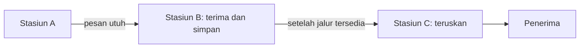
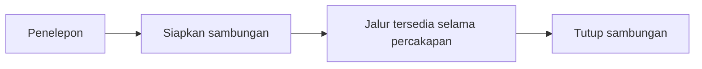
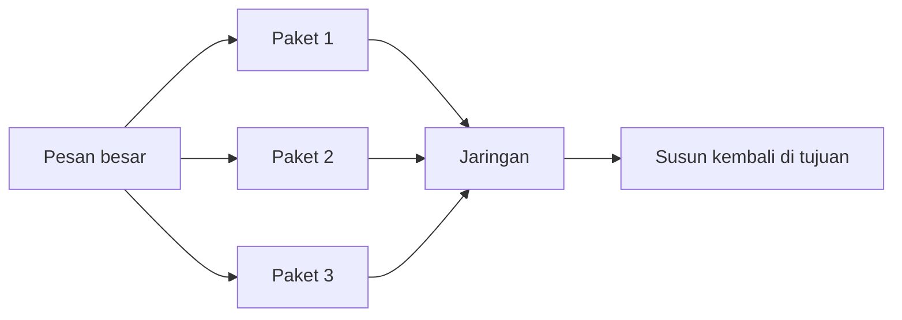
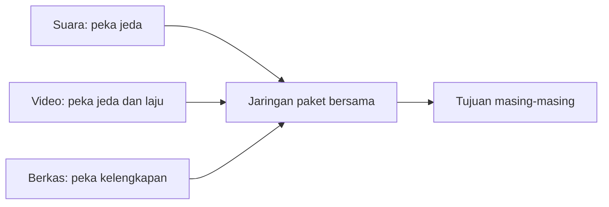
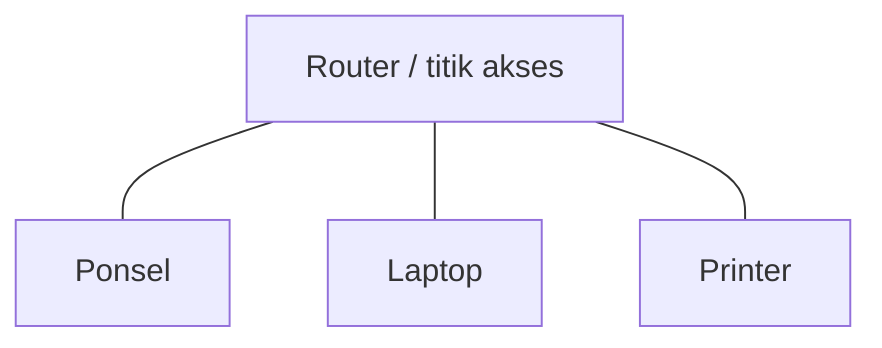

# Bab 1 — Jaringan Komunikasi dan Layanan

> Pertanyaan utama: mengapa jaringan telegraf, telepon, dan Internet memakai rancangan yang berbeda?

Susunan 1.1–1.3 dan nomor subbagiannya mengikuti daftar isi Bab 1 buku Leon-Garcia dan Widjaja, edisi kedua. Penjelasan memakai bahasa sendiri serta contoh dari slide kuliah. Baca berurutan; setiap bagian menjelaskan ide, contoh, lalu hal yang perlu diingat.

## 1.1 Evolusi Arsitektur dan Layanan Jaringan (*Evolution of Network Architecture and Services*)

Sensei menekan tombol kirim pada ponsel. Pesan itu tidak langsung “melompat” ke ponsel teman. Ponsel mengubah isi pesan menjadi data, jaringan membawanya melalui beberapa perangkat dan sambungan, lalu ponsel teman menampilkannya kembali.


*Jaringan komunikasi* adalah gabungan perangkat dan sarana yang memungkinkan informasi berpindah antarpengguna di tempat berbeda. Perangkatnya bisa berupa ponsel, komputer, *switch*, dan *router*. Sarananya bisa berupa gelombang radio, kabel tembaga, atau serat optik.

Tidak semua langkah di diagram harus terjadi secara langsung. Pada aplikasi pesan, layanan aplikasi dan koneksi Internet bisa melibatkan beberapa jaringan serta komputer perantara.

### Empat istilah yang sering tertukar

| Istilah | Pertanyaan yang dijawab | Contoh |
|---|---|---|
| **Aplikasi** | “Apa yang ingin dilakukan pengguna?” | Mengirim pesan, membuka web, menelepon |
| **Layanan komunikasi** | “Kemampuan pemindahan informasi apa yang tersedia?” | Mengirim data antarkomputer; membawa suara secara langsung |
| **Jaringan** | “Perangkat dan sambungan apa yang menyediakan kemampuan itu?” | Jaringan seluler, jaringan kampus, Internet |
| **Arsitektur jaringan** | “Bagaimana bagian jaringan disusun dan bekerja sama?” | Aturan alamat, cara meneruskan data, dan pembagian tugas antarbagian |

**Ingat:** aplikasi *memakai* layanan; jaringan *menyediakan* layanan. Kebutuhan layanan ikut menentukan arsitektur jaringan.

Kebutuhan aplikasi menentukan layanan yang harus disediakan. Pesan teks dapat menunggu sebentar; percakapan suara lebih peka terhadap jeda. Dari sini muncul tiga rancangan historis berikut.

### 1.1.1 Jaringan telegraf dan *message switching*

Telegraf membawa teks. Pesan diberi tujuan, diterima di sebuah stasiun, disimpan sementara, lalu diteruskan ke stasiun berikutnya. Proses ini disebut **store-and-forward**. Cara memindahkan pesan utuh antarstasiun disebut **message switching**.



**Kelebihan:** tidak perlu menyediakan jalur khusus dari awal sampai akhir. **Kendala:** pesan panjang dapat menahan pesan lain; setiap stasiun mungkin harus menunggu sampai pesan diterima lengkap. Konsep alamat, rute, dan penerusan dari telegraf masih penting pada jaringan modern.

### 1.1.2 Jaringan telepon dan *circuit switching*

Percakapan membutuhkan aliran suara dua arah dengan jeda kecil. Jaringan telepon tradisional memakai **circuit switching**: sebelum berbicara, jaringan menyiapkan sambungan dan menyediakan sumber daya pada jalur tersebut selama panggilan.



Analogi sederhana: seperti memesan satu ruang untuk percakapan. Selama dipesan, ruang itu siap dipakai meskipun kedua orang sedang diam. Ini membantu menjaga kelangsungan percakapan, tetapi sumber daya yang dipesan bisa menganggur.

### 1.1.3 Internet, jaringan komputer, dan *packet switching*

Komputer mengirim banyak jenis data: pesan singkat, halaman web, berkas besar, serta suara atau video. Dalam **packet switching**, pesan besar dipecah menjadi unit kecil yang disebut **paket**. Paket dapat berbagi jalur dengan paket dari pengguna lain.



**Kelebihan:** jalur dapat dibagi secara efisien; paket pendek dari pengguna lain tidak harus menunggu satu pesan panjang selesai seluruhnya. **Kendala:** paket dapat mengantre, hilang, atau tiba tidak berurutan. Protokol di bagian jaringan dan ujung komunikasi menangani kebutuhan seperti ini.

#### Bandingkan ketiganya

| Cara | Yang dipindahkan | Perlu sambungan yang disiapkan dahulu? | Contoh historis | Hal penting |
|---|---|---|---|---|
| **Message switching** | Pesan utuh | Tidak | Telegraf | Simpan, lalu teruskan pesan |
| **Circuit switching** | Aliran melalui jalur yang disediakan | Ya | Telepon tradisional | Sumber daya tersedia selama sambungan |
| **Packet switching** | Potongan data berupa paket | Tidak harus; tergantung jenis layanan | Internet | Paket berbagi jalur dan bisa mengantre |

**Jangan samakan “punya koneksi” pada aplikasi dengan circuit switching.** Koneksi TCP, misalnya, adalah hubungan logis antarujung di atas jaringan yang umumnya mengirim paket; bukan berarti satu sirkuit fisik dipesan sepanjang perjalanan.

#### Ikuti satu pesan sampai tujuan

1. Aplikasi membaca foto dan menyiapkan data untuk dikirim.
2. Data dibagi menjadi bagian-bagian yang dapat dibawa melalui jaringan.
3. Bagian-bagian itu dikirim sebagai paket, biasanya melalui Wi-Fi atau seluler, lalu melintasi perangkat jaringan lain.
4. Alamat membantu jaringan menemukan tujuan berikutnya. Perangkat di tengah memilih jalur dan meneruskan paket.
5. Bagian yang perlu dikirim ulang ditangani sesuai protokol yang dipakai. Setelah data lengkap, aplikasi penerima menampilkan foto.

Pada pengiriman nyata, layanan aplikasi bisa memakai server penyimpanan sementara. Jadi, contoh ini menggambarkan prinsip jaringan, bukan janji bahwa semua aplikasi mengirim foto langsung dari satu ponsel ke ponsel lain.

## 1.2 Arsitektur Jaringan Masa Depan dan Layanannya (*Future Network Architectures and Their Services*)

Bagian ini mengajak kita bertanya: bisakah satu jaringan membawa banyak layanan dengan kebutuhan yang berbeda? Pada masa jaringan telepon tradisional, suara terutama memakai sirkuit; Internet tumbuh dengan paket. Arah yang dibahas buku adalah jaringan multiservis: suara, video, dan data berbagi infrastruktur berbasis paket, dengan cara pengelolaan yang sesuai kebutuhan masing-masing.

Contoh sederhana: unduhan berkas membutuhkan semua data sampai dengan benar, sedangkan panggilan suara membutuhkan jeda yang kecil agar percakapan terasa alami. Keduanya dapat melewati jaringan paket, tetapi perlakuan terhadap keterlambatan, kehilangan data, dan pembagian kapasitas bisa berbeda. Istilah pentingnya adalah *quality of service* (QoS), yaitu sasaran mutu layanan seperti jeda dan kehilangan paket. QoS bukan janji bahwa semua paket pasti tiba tepat waktu.



**Ingat:** “masa depan” di sini adalah sudut pandang buku terbitan 2003/2004. Contoh teknologi masa kini tidak otomatis menjadi isi asli buku.

## 1.3 Faktor Kunci dalam Evolusi Jaringan Komunikasi (*Key Factors in Communication Network Evolution*)

Buku menekankan empat faktor. Keberhasilan layanan baru tidak ditentukan oleh teknologi saja.

| Faktor | Pertanyaan sederhana | Contoh |
|---|---|---|
| **Teknologi** | Bisakah layanan dibuat dengan mutu dan biaya yang masuk akal? | Serat optik menyediakan kapasitas besar. |
| **Kebutuhan pasar** | Apakah orang atau organisasi membutuhkannya? | Permintaan panggilan video meningkat ketika kerja jarak jauh meluas. |
| **Regulasi** | Apakah aturan mengizinkan dan mengatur pemakaiannya? | Penggunaan spektrum radio harus mengikuti ketentuan yang berlaku. |
| **Standar** | Bisakah perangkat dan layanan dari pembuat berbeda saling bekerja? | Standar membuat perangkat jaringan dapat bertukar data. |

Analogi: sebuah kereta cepat memerlukan mesin yang mampu, penumpang yang membutuhkan, izin serta aturan keselamatan, dan ukuran rel yang cocok. Keempatnya saling mendukung.

### 1.3.1 Peran teknologi (*Role of Technology*)

Teknologi menentukan kemampuan nyata jaringan: kapasitas serat optik, kemampuan pemrosesan perangkat, dan teknik transmisi. Jika biaya per bit turun, layanan yang sebelumnya terlalu mahal bisa menjadi masuk akal. Namun kemampuan teknis saja belum membuat sebuah layanan digunakan.

### 1.3.2 Peran regulasi (*Role of Regulation*)

Aturan menentukan, misalnya, siapa yang boleh menyediakan layanan dan bagaimana spektrum radio dipakai. Perubahan aturan dapat membuka atau membatasi cara jaringan dibangun. Rincian aturan tiap negara dan masa dapat berbeda.

### 1.3.3 Peran pasar (*Role of the Market*)

Pengguna dan organisasi memilih layanan yang menyelesaikan masalah dengan biaya yang cocok. Permintaan dapat mendorong penyedia memperluas jaringan. Teknologi yang menarik secara teknis belum tentu dipakai luas jika kebutuhannya kecil.

### 1.3.4 Peran standar (*Role of Standards*)

Standar adalah kesepakatan bersama agar perangkat dan jaringan dari pembuat berbeda dapat berkomunikasi. Tanpa kesepakatan format dan aturan pertukaran, tiap jaringan mudah menjadi pulau tersendiri.

## Pelengkap kuliah: fungsi dan pengelompokan jaringan

Bagian berikut membantu memahami istilah pada slide dan kontrak, tetapi bukan subbab tersendiri dalam daftar isi Bab 1 buku.

### Pekerjaan dasar jaringan

Bayangkan pengiriman paket belanja. Kurir perlu tahu tujuan, memilih rute, membawa barang dari satu titik ke titik berikutnya, dan menangani keterlambatan. Jaringan mempunyai pekerjaan serupa:

1. **Representasi informasi.** Pesan, suara, dan gambar harus dapat dikirim sebagai sinyal. Dalam jaringan komputer, informasi biasanya direpresentasikan sebagai bit (`0` dan `1`).
2. **Pengalamatan.** Jaringan perlu mengenali tujuan. Alamat pada paket data berperan seperti alamat pada kiriman.
3. **Pemilihan rute (*routing*).** Jaringan menentukan jalur atau titik berikutnya menuju tujuan.
4. **Penerusan (*forwarding*).** Perangkat benar-benar mengirim data melalui keluaran yang dipilih. Memilih jalan dan menjalankan perpindahan adalah dua pekerjaan berbeda.
5. **Berbagi sarana.** Banyak pengguna memakai kabel atau gelombang radio yang sama. Jaringan perlu mengatur pemakaiannya.
6. **Mengatasi gangguan.** Data dapat rusak, hilang, terlambat, atau datang tidak berurutan. Cara penanganannya bergantung pada layanan dan protokol.

Contoh: *router* membaca tujuan paket, memilih keluaran yang tepat, lalu meneruskannya. Ketika jalur ramai, paket mungkin harus menunggu dalam antrean.

### Istilah ukuran yang sering muncul

- **Laju transmisi** menyatakan banyaknya bit yang dapat dikirim per detik, misalnya 10 Mbps berarti 10 juta bit per detik menurut satuan desimal jaringan.
- **Waktu tunda (*delay/latency*)** menyatakan berapa lama data menempuh perjalanan. Laju tinggi tidak otomatis berarti waktu tunda kecil.
- **Kapasitas jalur** ialah batas kemampuan jalur; **throughput** ialah laju data yang benar-benar tercapai. Jalur 100 Mbps bisa menghasilkan throughput lebih rendah akibat berbagi jalur, gangguan, dan pekerjaan tambahan protokol.

### Cara mengelompokkan jaringan

Satu jaringan bisa masuk ke beberapa kelompok sekaligus. Karena itu, tanyakan dulu: **dikelompokkan berdasarkan apa?**

| Dasar pengelompokan | Jenis dan contoh | Pertanyaan yang dijawab |
|---|---|---|
| **Cakupan wilayah** | LAN: satu rumah, gedung, atau kampus kecil; MAN: skala kota; WAN: wilayah luas | Seberapa luas jaringan itu? |
| **Media** | Kabel tembaga, serat optik, atau nirkabel | Lewat apa sinyal bergerak? |
| **Pola hubungan** | Titik ke titik, atau media yang dipakai bersama | Siapa berbagi sambungan? |
| **Pola pengiriman** | *Unicast* ke satu penerima; *broadcast* ke semua anggota satu ranah; *multicast* ke kelompok tertentu | Kepada siapa data ditujukan? |
| **Cara pemindahan** | Message, circuit, atau packet switching | Bagaimana informasi menempuh jaringan? |

**Contoh gabungan:** Wi-Fi rumah biasanya bagian dari LAN, memakai media nirkabel, dan menghubungkan banyak perangkat melalui satu titik akses. Ketika perangkat membuka situs di luar rumah, paketnya lalu melewati jaringan lain hingga mencapai server. Internet adalah *jaringan dari banyak jaringan*, bukan sinonim untuk satu LAN.

### Topologi sederhana

*Topologi* menggambarkan susunan hubungan perangkat. Bentuknya dapat berupa bintang, cincin, atau jejaring. Pada jaringan rumah, perangkat sering terhubung ke satu titik akses atau *switch* sehingga tampak seperti bintang. Bentuk fisik tidak selalu sama dengan jalur logis yang ditempuh data.



### Langkah memilih rancangan

**Mulai dari kebutuhan layanan**, bukan dari nama perangkat. Contoh:

1. **Tentukan pengguna dan jenis informasi.** Apakah perlu suara langsung, pesan teks, berkas besar, atau siaran ke banyak orang?
2. **Tentukan syaratnya.** Seberapa cepat harus sampai? Bolehkah ada jeda? Perlukah data diterima utuh? Berapa banyak pengguna yang aktif bersamaan?
3. **Pilih cara berbagi sumber daya.** Jalur yang disediakan khusus cocok untuk kebutuhan tertentu; paket yang berbagi jalur memberi keluwesan untuk lalu lintas yang berubah-ubah.
4. **Rancang alamat, rute, dan aturan komunikasi.** Perangkat harus sepakat cara mengirim, menerima, dan menangani gangguan. Kesepakatan aturan ini disebut **protokol**.
5. **Periksa biaya, kemampuan tumbuh, dan keamanan.** Jaringan kecil yang baik belum tentu cukup saat pengguna bertambah banyak.

Bab berikutnya membahas *layering* atau pembagian pekerjaan ke beberapa lapisan. Untuk Bab 1, cukup pahami bahwa pembagian tugas membuat jaringan yang rumit lebih mudah dirancang dan diperbaiki.

## Ringkasan

```text
Aplikasi ingin berkomunikasi
           ↓ memakai
Layanan komunikasi: kemampuan memindahkan informasi
           ↓ disediakan oleh
Jaringan: perangkat + media + aturan
           ↓ dirancang menurut
Kebutuhan pengguna, biaya, teknologi, regulasi, standar
```

- Telegraf menonjolkan **pesan utuh dan store-and-forward**.
- Telepon tradisional menonjolkan **sirkuit yang disiapkan untuk percakapan**.
- Internet menonjolkan **paket yang berbagi jalur**.
- Alamat menjawab **ke mana**, *routing* menjawab **lewat mana**, *forwarding* adalah **memindahkan ke langkah berikutnya**.
- LAN/MAN/WAN menjelaskan **cakupan**, bukan cara switching.

## Latihan bertahap

Tutup bagian kunci dahulu. Jawab dengan satu atau dua kalimat; tidak perlu menghafal kalimat buku.

1. Sensei membuka situs dari ponsel. Sebutkan contoh aplikasi, layanan komunikasi, dan jaringan yang terlibat.
2. Mengapa aplikasi yang memindahkan berkas besar dan aplikasi telepon memiliki kebutuhan jaringan yang berbeda?
3. Di stasiun telegraf, pesan diterima seluruhnya, disimpan, lalu diteruskan. Apa nama pola ini?
4. Sebuah panggilan telepon tradisional sudah menyiapkan jalur. Apa manfaatnya, dan apa sumber daya yang mungkin terbuang?
5. Mengapa memecah pesan besar menjadi paket membantu pengguna lain yang juga memakai jalur?
6. Apa beda alamat, *routing*, dan *forwarding*?
7. Jaringan Wi-Fi rumah termasuk LAN. Apakah itu berarti semua jaringan LAN memakai Wi-Fi? Jelaskan.
8. Sebutkan empat faktor yang memengaruhi keberhasilan layanan komunikasi baru.

<details>
<summary>Kunci dan alasan singkat</summary>

1. Aplikasi: peramban web. Layanan: pertukaran data antara ponsel dan server. Jaringan: Wi-Fi rumah, jaringan penyedia Internet, dan jaringan menuju server.
2. Berkas besar mengutamakan data lengkap dan laju yang memadai; percakapan mengutamakan jeda kecil dan aliran yang berkesinambungan. Keduanya tetap membutuhkan ketepatan pada tingkat yang sesuai.
3. **Store-and-forward**; pada contoh telegraf, pesannya dipindahkan sebagai satu kesatuan melalui **message switching**.
4. Jalur siap dipakai sehingga aliran percakapan lebih terjaga. Sumber daya jalur yang dipesan dapat menganggur ketika orang diam.
5. Jaringan dapat menyisipkan paket pengguna lain di antara paket-paket pesan besar; tidak harus menunggu seluruh pesan panjang selesai.
6. Alamat menunjukkan tujuan; *routing* menentukan jalur; *forwarding* mengirim data ke titik berikutnya menurut pilihan itu.
7. Tidak. LAN menunjukkan cakupan wilayah. LAN juga dapat memakai kabel Ethernet.
8. Teknologi, kebutuhan pasar, regulasi, dan standar.

</details>

## Rujukan dan batasan

- Kontrak KOM1314 Semester 1 2026/2027, tabel “Topik Perkuliahan”, pertemuan 1.
- Leon-Garcia dan Widjaja, *Communication Networks: Fundamental Concepts and Key Architectures*, edisi ke-2, Bab 1 §1.1–1.3.
- Slide kuliah `Garcia-2003_ch1-Communication Networks and Services`, khususnya bagian layanan, evolusi arsitektur, packet versus circuit switching, dan faktor keberhasilan layanan.

Ini adalah penjelasan ulang untuk belajar. Contoh aplikasi masa kini dipakai untuk mempermudah konsep dari buku tahun 2003/2004; rincian teknologi saat ini dapat berbeda dari contoh historis dalam bacaan.
