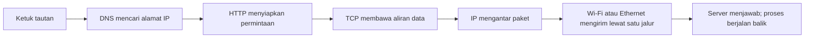
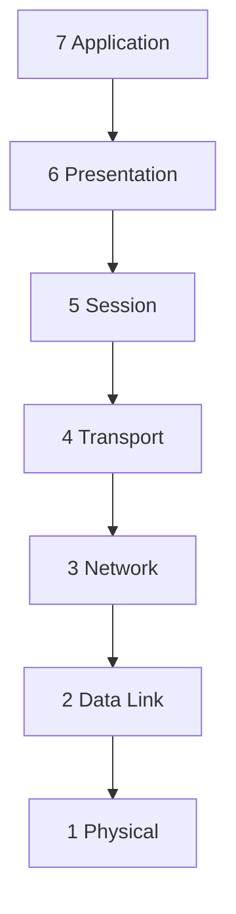
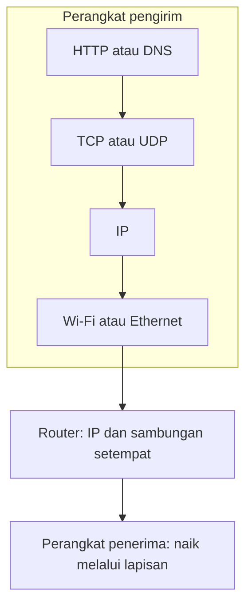

# Bab 2 — Aplikasi dan Arsitektur Berlapis

> Pertanyaan utama: ketika sebuah situs terbuka di laptop, siapa mengerjakan apa?

Bab ini mengikuti pertemuan 2 kontrak KOM1314: konsep *layering*, model OSI, gambaran TCP/IP, serta protokol aplikasi dan utilitas. Penjelasan mengikuti Bab 2 dan slide *Applications and Layered Architectures* karya Leon-Garcia dan Widjaja. Contoh alamat dan perilaku di sini disederhanakan untuk belajar.

## 1. Mulai dari satu kejadian: membuka situs

Sensei mengetik nama situs dan menekan Enter. Agar halaman tampil, beberapa pekerjaan berbeda perlu selesai:

1. **DNS** mencari alamat IP yang sesuai dengan nama situs. Ini seperti mencari nomor tujuan dari nama kontak.
2. Peramban menyiapkan komunikasi dengan server. Pada contoh **HTTP melalui TCP**, TCP mengurus aliran data antaraplikasi dan pengiriman ulang ketika diperlukan.
3. **HTTP** menyatakan halaman apa yang diminta dan bagaimana server menjawab. Misalnya, permintaan `GET /` dapat dibalas dengan isi halaman.
4. **IP** membawa paket menuju jaringan tujuan melalui perangkat perantara.
5. Teknologi jaringan setempat, seperti Ethernet atau Wi-Fi, memindahkan data ke tetangga berikutnya; media fisik membawa sinyalnya.



Ini **contoh alur dari slide**, bukan syarat setiap situs masa kini. HTTPS menambahkan perlindungan TLS, dan HTTP/3 dapat memakai QUIC di atas UDP. Pokok pelajarannya tetap sama: satu tindakan pengguna memerlukan kerja sama beberapa lapisan.

## 2. Tiga kata yang wajib dibedakan

| Istilah | Arti sederhana | Contoh |
|---|---|---|
| **Lapisan (*layer*)** | Kelompok pekerjaan yang sejenis | Lapisan transport menangani komunikasi antarproses. |
| **Layanan (*service*)** | Kemampuan yang diberikan sebuah lapisan kepada lapisan di atasnya | TCP menyediakan aliran byte yang andal bagi aplikasi. |
| **Protokol (*protocol*)** | Aturan pertukaran pesan antara pihak setingkat | TCP mengatur nomor urut, pengakuan penerimaan, dan pengiriman ulang. |

Bayangkan kantor pos. Bagian loket menyediakan **layanan** menerima kiriman. Dua kantor pos memakai **aturan** bersama tentang label dan penanganan kiriman: itulah analogi protokol. Loket dan pengangkutan adalah **lapisan tugas** yang berbeda. Analogi ini membantu mengingat pembagian kerja, tetapi paket jaringan tidak persis sama dengan paket pos.

*Protokol* menentukan bentuk pesan, kapan pesan dikirim, serta tindakan saat pesan diterima atau waktunya habis. Contoh: HTTP mengenal permintaan dan respons; TCP mempunyai aturan untuk mendeteksi data yang belum diterima dan mengirimnya kembali.

### Mengapa tugas dibagi menjadi lapisan?

Masalah besar menjadi beberapa masalah kecil. Pengembang peramban dapat memakai layanan transport tanpa merancang ulang kabel; teknologi Wi-Fi dapat berubah tanpa mengubah arti permintaan HTTP. Pembagian ini membantu desain, pengujian, dan penggantian bagian. Tetap ada biaya tambahan, seperti informasi kendali pada tiap lapisan.

## 3. Model OSI: tujuh lapisan untuk memetakan pekerjaan

Baca tabel **dari atas ke bawah** ketika mengirim, lalu **dari bawah ke atas** ketika menerima.

| No. | Lapisan OSI | Pekerjaan inti | Pertanyaan pengingat |
|---|---|---|---|
| 7 | Application | Menyediakan fungsi komunikasi yang dipakai aplikasi, misalnya web atau DNS | Layanan aplikasi apa yang diminta? |
| 6 | Presentation | Mengatur representasi data agar kedua pihak memahaminya | Bagaimana data diwakili? |
| 5 | Session | Mengelola dialog atau sesi komunikasi | Bagaimana percakapan diatur? |
| 4 | Transport | Mengantar data antaraplikasi di ujung, termasuk port dan, bila dipakai, keandalan | Aplikasi mana di komputer tujuan? |
| 3 | Network | Mengantar paket melewati beberapa jaringan, termasuk alamat dan rute | Komputer tujuan ada di jaringan mana? |
| 2 | Data Link | Mengantar *frame* melalui satu sambungan langsung | Bagaimana mencapai tetangga berikutnya? |
| 1 | Physical | Mengirim bit sebagai sinyal melalui media | Bagaimana 0 dan 1 dikirim? |



**Jebakan ujian:** OSI adalah *model acuan*. Internet sehari-hari terutama menggunakan keluarga protokol TCP/IP, bukan kewajiban menjalankan tujuh protokol OSI secara terpisah. Fungsi presentasi dan sesi sering dikerjakan di tingkat aplikasi atau pustaka yang dipakainya.

### Ujung dan perangkat perantara

Pada contoh sederhana, aplikasi dan transport berjalan pada perangkat pengirim serta penerima. *Router* di tengah terutama membaca informasi lapisan jaringan untuk meneruskan paket, lalu memakai data link dan fisik pada tiap sambungannya. Tidak perlu menganggap router biasa membaca isi HTTP untuk dapat meneruskan paket.

## 4. TCP/IP: susunan yang dipakai Internet

Slide kuliah menggambarkan aplikasi di atas **TCP atau UDP**, di atas **IP**, di atas berbagai antarmuka jaringan. Untuk belajar, susunannya dapat ditulis begini:

| Susunan TCP/IP sederhana | Contoh | Padanan fungsi pada OSI |
|---|---|---|
| Aplikasi | HTTP, DNS, SMTP | Terutama lapisan 7; sebagian fungsi 5–6 berada di sini |
| Transport | TCP, UDP | Lapisan 4 |
| Internet | IP | Lapisan 3 |
| Akses jaringan | Ethernet, Wi-Fi, media fisik | Lapisan 2 dan 1 |

Beberapa buku memisahkan akses jaringan menjadi *data link* dan *physical*, sehingga TCP/IP digambar sebagai **lima** lapisan. Empat dan lima sama-sama bisa dipakai sebagai penyederhanaan; sebutkan pembagian yang dipakai sebelum membandingkannya.



**TCP** memberi aliran byte andal dan memakai sambungan logis. **UDP** memberi datagram tanpa jaminan pengiriman atau urutan dari UDP itu sendiri. **IP** memberi pengiriman paket *best effort* antardevais. Memakai TCP di atas IP tidak mengubah IP menjadi protokol yang menjamin setiap paket sampai; keandalan TCP ditangani pada lapisan transport.

## 5. Data turun lapisan: pembungkusan (*encapsulation*)

Misalkan aplikasi mengirim teks `HALO`. Tiap lapisan menambahkan informasi yang dibutuhkan untuk pekerjaannya. Informasi depan disebut **header**; data link dapat pula menambah **trailer** untuk pemeriksaan kesalahan.

```text
Aplikasi:    HALO
Transport:  [header TCP][HALO]                         → segmen TCP
Internet:   [header IP][header TCP][HALO]              → paket IP
Data link:  [header link][header IP][header TCP][HALO][trailer] → frame
Fisik:      bit-bit dari frame dikirim sebagai sinyal
```

Penerima membukanya dalam urutan sebaliknya. Proses ini disebut **decapsulation**. Di router, frame dari satu sambungan dibuka hingga paket IP, lalu paket itu dibungkus menjadi frame baru untuk sambungan berikutnya. Karena itu, header link dapat berubah sepanjang perjalanan, sedangkan tujuan IP pada contoh biasa tetap menunjuk tujuan akhir.

Jangan hafal nama unit tanpa konteks: istilah umum adalah **PDU** (*protocol data unit*), yakni unit yang dipertukarkan oleh dua pihak pada lapisan yang sama. Data dari lapisan atas yang diserahkan ke lapisan bawah disebut **SDU** (*service data unit*). Bagi lapisan bawah, SDU itu menjadi isi yang dibungkus dalam PDU miliknya.

### Potong, gabung, dan bagikan

Jika data terlalu besar, lapisan dapat **memecah**nya menjadi beberapa unit dan penerima **menyatukannya kembali**. Jika banyak aplikasi memakai satu komputer, lapisan transport memakai **nomor port** untuk membedakan alirannya. Ini contoh *multiplexing*: banyak pengguna layanan berbagi lapisan di bawahnya. Alamat IP mengidentifikasi antarmuka pada jaringan; port membantu memilih proses atau layanan pada perangkat tersebut.

## 6. Protokol aplikasi yang sering ditanya

| Nama | Fungsi utama | Hubungan yang perlu diingat |
|---|---|---|
| DNS | Menerjemahkan nama domain menjadi informasi alamat, dan jenis catatan lain | Pertanyaan singkat lazimnya lewat UDP; TCP juga dapat digunakan. |
| HTTP | Meminta dan mengirim sumber daya web | Contoh di slide memakai TCP. |
| SMTP | Mengirim surel antar sistem surat | Protokol aplikasi. |
| FTP | Memindahkan file dalam contoh klasik buku | Contoh klasik memakai koneksi kendali dan data terpisah. |

Contoh yang sering tertukar: **DNS dan HTTP sama-sama protokol aplikasi**, walau DNS mencari alamat dan HTTP meminta isi web. **TCP dan UDP sama-sama protokol transport**. **IP adalah protokol lapisan Internet/jaringan**.

### Utilitas untuk mengamati jaringan

- `ping` memakai ICMP Echo untuk mencoba mengetahui apakah tujuan menjawab dan mengukur waktu pulang-pergi. Tidak ada jawaban tidak selalu berarti perangkat mati; balasan dapat diblokir.
- `traceroute` atau `tracert` mencoba menunjukkan titik perantara dengan membatasi umur paket (*TTL* atau *hop limit*). Hasilnya bisa tidak lengkap jika perangkat perantara tidak menjawab.
- `ipconfig` pada Windows atau `ip addr` pada Linux menampilkan informasi alamat lokal. `netstat` atau `ss` membantu melihat sambungan dan soket. Nama perintah berbeda menurut sistem.

Ini alat pengamatan, bukan lapisan baru dalam OSI.

## 7. Dua cara layanan berkomunikasi

| Sifat | Berorientasi koneksi | Tanpa koneksi |
|---|---|---|
| Sebelum data utama | Ada tahap membentuk hubungan logis | Tidak perlu tahap pembentukan hubungan pada protokol itu |
| Contoh | TCP | UDP, IP |
| Hal yang harus diingat | “Koneksi” TCP bukan sirkuit fisik yang dipesan | “Tanpa koneksi” tidak berarti mustahil membangun keandalan pada lapisan lain |

Jenis layanan di dua lapisan tidak harus sama. TCP yang berorientasi koneksi dapat bekerja di atas IP yang tanpa koneksi.

## 8. Peta cepat menjelang ujian

```text
Nama situs → DNS → alamat IP
Permintaan halaman → HTTP → memakai layanan transport
Transport → TCP/UDP → membedakan aplikasi dengan port
Internet → IP → mengantar paket antarnetwork
Data link → frame → mencapai tetangga pada satu sambungan
Fisik → bit sebagai sinyal

Lapisan = pembagian pekerjaan
Layanan = kemampuan bagi lapisan di atas
Protokol = aturan antar pihak setingkat
```

## 9. Latihan bertahap

Jawab dahulu tanpa membuka kunci.

1. Sensei membuka `contoh.id`. Mengapa DNS diperlukan sebelum peramban menghubungi server memakai nama itu?
2. Bedakan lapisan, layanan, dan protokol dengan satu contoh TCP.
3. Urutkan: IP, HTTP, Ethernet, TCP, saat data dikirim dari aplikasi ke kabel.
4. Pada OSI, lapisan mana yang menangani rute antarbeberapa jaringan? Lapisan mana yang membawa frame ke tetangga langsung?
5. Mengapa dua aplikasi pada satu komputer dapat memakai jaringan bersamaan tanpa setiap balasan tertukar?
6. Apa beda model OSI dan susunan TCP/IP yang dipakai Internet?
7. Jika TCP bekerja di atas IP, apakah IP otomatis menjamin semua paket diterima? Jelaskan.
8. Apa yang terjadi pada frame ketika paket melewati router menuju sambungan lain?
9. Apakah tidak ada balasan `ping` membuktikan server mati? Jelaskan.
10. Sebutkan satu alasan mengapa UDP masih berguna meskipun tidak memberi jaminan pengiriman sendiri.

<details>
<summary>Kunci jawaban dan alasan</summary>

1. Nama mudah diingat manusia, sedangkan komunikasi jaringan membutuhkan alamat IP tujuan. DNS membantu menemukan alamat itu.
2. Transport adalah lapisan; aliran byte andal adalah layanan yang TCP berikan kepada aplikasi; TCP adalah protokol, yaitu aturan antarujung untuk menjalankan layanan tersebut.
3. HTTP → TCP → IP → Ethernet. Di bawah Ethernet, sinyal dikirim melalui media fisik.
4. Network/lapisan 3 mengurus perjalanan antarnetwork. Data Link/lapisan 2 mengurus frame pada satu sambungan.
5. Nomor port pada lapisan transport membantu membedakan proses atau layanan tujuan.
6. OSI adalah model acuan tujuh lapisan. TCP/IP ialah keluarga protokol nyata yang lazim disusun menjadi empat atau lima lapisan untuk penjelasan.
7. Tidak. IP memberi layanan *best effort*; TCP menambahkan mekanisme keandalan pada lapisan transport.
8. Router menerima frame, mengambil paket IP, memilih sambungan berikutnya, lalu membungkus paket dalam frame yang sesuai dengan sambungan keluar.
9. Tidak. ICMP bisa diblokir, dibatasi, atau balasannya hilang.
10. UDP sederhana dan tidak mewajibkan pembentukan koneksi pada UDP. Aplikasi dapat memilihnya ketika karakter itu cocok dan menangani kebutuhan tambahan sendiri.

</details>

## Rujukan dan batasan

- Kontrak perkuliahan KOM1314 Semester 1 2026/2027, tabel topik **pertemuan 2**.
- Alberto Leon-Garcia dan Indra Widjaja, *Communication Networks: Fundamental Concepts and Key Architectures*, edisi ke-2, Bab 2: “Applications and Layered Architectures”.
- Slide kuliah `Garcia-2003_ch2-Applications and Layered Architectures.pdf`, bagian *Protocols, Services & Layering*, *OSI Reference Model*, *TCP/IP Architecture*, dan *Application Layer Protocols & Utilities*.

Materi ini ditulis ulang untuk belajar. Contoh teknologi modern diberi penanda bila berbeda dari alur klasik pada slide; contoh alamat, perintah, dan hasil jaringan bukan hasil pengukuran nyata.
