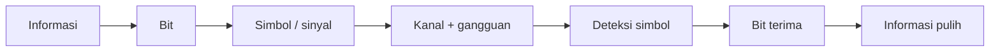

# Bab 3 — Dasar Transmisi Digital

> Pertanyaan utama: bagaimana informasi berubah menjadi bit, menjadi sinyal, lalu pulih lagi di penerima?

Urutan 3.1–3.9 mengikuti buku Leon-Garcia dan Widjaja. Bab ini juga menjadi bahan pertemuan 3–4 pada kontrak kuliah. Contoh hitungan di sini dibuat ulang untuk belajar, bukan disalin dari soal buku. Anggap `k` = 1.000 dan `M` = 1.000.000 kecuali dinyatakan lain.

## 3.1 Representasi Digital Informasi

*Bit* hanya punya dua nilai, 0 dan 1. Aturan pengkodean memberi arti pada urutan bit: `01000001` dapat berarti huruf A dalam ASCII, tetapi urutan yang sama dapat berarti bilangan 65. Penerima perlu tahu formatnya. Jangan campur **bit rate** (bit/detik), **baud** (simbol/detik), dan **ukuran data** (bit atau byte). Satu byte biasanya delapan bit; satu simbol dapat mewakili lebih dari satu bit.

### 3.1.1 Informasi berbentuk blok

Berkas, gambar, dan pesan dapat dipandang sebagai blok terbatas. Blok diberi batas, panjang, dan kadang pemeriksa kesalahan. Jika 100 byte harus dikirim pada 1 Mb/s, waktu mengirim bitnya saja ialah `100 × 8 / 1.000.000 = 0,0008 detik`. Ini **waktu transmisi**, belum termasuk perjalanan sinyal, antrian, dan pemrosesan.

Ukuran hasil pengkodean bergantung pada format serta kompresi. Kompresi *lossless* harus memungkinkan data asli pulih tepat; kompresi *lossy* membuang rincian yang dianggap kurang penting. Berkas yang sudah terkompresi biasanya tidak mengecil banyak ketika dikompresi lagi.

### 3.1.2 Informasi berbentuk aliran

Suara dan video dihasilkan terus-menerus. Untuk aliran, rata-rata bit rate harus cukup agar penyangga (*buffer*) tidak terus kosong atau penuh. Jika sumber mengeluarkan 64 kb/s tetapi kanal efektif hanya 48 kb/s, tumpukan bertambah 16 kb setiap detik. Aliran langsung juga peduli **jitter**, yaitu perubahan jeda antarbagian yang datang. Buffer dapat meredam jitter, dengan harga tambahan waktu tunggu.

## 3.2 Mengapa Komunikasi Digital?

### 3.2.1 Analog dibanding digital

Sinyal analog berubah kontinu. Penguat analog memperkuat sinyal **beserta derau**. Pada transmisi digital, penerima memutuskan apakah sinyal mewakili simbol 0 atau 1; *regenerator* kemudian membentuk pulsa bersih kembali bila derau belum membuat keputusan salah. Itulah sebabnya transmisi digital dapat lebih tahan terhadap derau berantai. Digital tetap bisa salah: derau besar, pelemahan, atau waktu sampling keliru dapat membalik bit.

Digital memudahkan penyimpanan, enkripsi, kompresi, pemeriksaan kesalahan, dan penggabungan layanan. Biayanya ialah konversi, sinkronisasi, dan kebutuhan laju bit tertentu. **Digital tidak otomatis lebih hemat spektrum atau bebas gangguan.**

### 3.2.2 Sifat dasar sistem transmisi digital

Pengirim memberi satu simbol pada suatu **interval simbol**. Penerima harus tahu kapan mengambil keputusan (**sinkronisasi waktu**) dan ambang/nilai simbol yang sah. Pada kanal berderau, keputusan dapat salah: *bit error rate* (BER) ialah bagian bit yang salah dari semua bit yang diperiksa. Contoh: 10 bit salah dalam 1.000.000 bit berarti BER terukur `10^-5`; angka itu adalah pengamatan, bukan jaminan untuk setiap kelompok bit.

## 3.3 Representasi Digital Sinyal Analog

Alur telepon digital sederhana: suara → pembatas frekuensi → sampling → kuantisasi → kode biner → pengiriman. Di penerima, kode diubah kembali menjadi perkiraan sinyal analog. Yang pulih bukan gelombang identik sempurna karena kuantisasi membulatkan amplitudo.

### 3.3.1 Lebar pita sinyal analog

*Bandwidth* sinyal dalam hertz adalah rentang frekuensi pentingnya. Sinyal suara telepon kira-kira dibatasi ke beberapa kilohertz. **Bandwidth Hz** bukan **bit rate b/s**. Hubungannya bergantung pada jumlah tingkat sinyal serta derau kanal.

### 3.3.2 Sampling sinyal analog

Jika komponen tertinggi sinyal adalah `B` Hz dan sinyal telah dibatasi sesuai asumsi, teorema sampling mensyaratkan laju sampel **lebih dari** `2B` sampel/detik untuk rekonstruksi ideal. Praktik memberi ruang untuk filter. Untuk suara dibatasi sekitar 4 kHz, contoh yang biasa dipakai adalah 8.000 sampel/detik. Sampling yang terlalu lambat membuat komponen tinggi tampak sebagai frekuensi lain (*aliasing*); filter sebelum sampling mencegahnya.

### 3.3.3 Pengiriman digital sinyal analog

Setiap sampel dibulatkan ke salah satu tingkat (*quantization*), lalu tingkat itu diberi kode. Bila satu sampel memakai 8 bit dan ada 8.000 sampel/detik, laju dasar PCM = `8.000 × 8 = 64.000 b/s = 64 kb/s`. Tambahan pembingkaian atau kendali dapat menaikkan laju di jalur. PCM membawa perkiraan sampel, bukan huruf atau teks.

### 3.3.4 SNR kuantisasi (pilihan)

Lebih banyak bit per sampel memberi lebih banyak tingkat dan biasanya galat pembulatan lebih kecil. Dengan kuantisasi seragam ideal pada sinus skala penuh, aturan pendekatan SNR kuantisasi ialah sekitar `6,02b + 1,76 dB` untuk `b` bit. Ini **bukan** rumus untuk semua jenis suara atau kuantisator; kekuatan sinyal dan rancangan kuantisator turut berpengaruh. Kompresi amplitudo (*companding*) memberi ketelitian relatif lebih baik untuk suara lemah.

## 3.4 Karakteristik Kanal Komunikasi

### 3.4.1 Sudut pandang frekuensi

Kanal tidak melewatkan semua frekuensi dengan penguatan dan fase yang sama. **Redaman** mengecilkan daya; **distorsi** mengubah bentuk karena komponen frekuensi diperlakukan berbeda; **derau** menambah gangguan. SNR = daya sinyal/daya derau. Dalam desibel, `SNR_dB = 10 log10(S/N)`, jadi rasio 100 setara 20 dB. Kanal dengan bandwidth 3 kHz tidak berarti setiap gelombang di atas 3 kHz terpotong tepat; batas itu umumnya ukuran praktis respons frekuensi.

### 3.4.2 Sudut pandang waktu

Pulsa yang dikirim dapat melebar dan bertumpuk dengan pulsa berikutnya: *intersymbol interference* (ISI). Sinyal juga butuh waktu merambat. **Delay propagasi** = jarak / kecepatan rambat, sedangkan **delay transmisi** = panjang data / bit rate. Untuk 1.000 bit pada 1 Mb/s, transmisi 1 ms; perjalanan 200 km pada 2 × 10^8 m/s juga 1 ms. Keduanya berbeda dan dapat terjadi bersama.

## 3.5 Batas Fundamental Transmisi Digital

### 3.5.1 Laju pensinyalan Nyquist

Untuk kanal *ideal tanpa derau* dengan bandwidth `B` Hz, laju simbol maksimum ideal adalah `2B` simbol/detik. Jika tiap simbol punya `M` tingkat yang dapat dibedakan, batas laju bit ideal = `2B log2(M)` b/s. Contoh `B = 3.000 Hz`, `M = 4`: `2 × 3.000 × 2 = 12.000 b/s`. Menambah tingkat menuntut keputusan penerima lebih teliti; derau membatasi manfaatnya.

### 3.5.2 Kapasitas Shannon

Untuk kanal berderau dengan asumsi model Shannon, `C = B log2(1 + S/N)` b/s. Contoh `B = 3.000 Hz` dan `S/N = 15`: `C = 3.000 × log2(16) = 12.000 b/s`. Kapasitas adalah batas teoritis untuk komunikasi andal dengan pengkodean yang sesuai, **bukan** laju pasti modem atau satu paket. Nyquist dan Shannon menjawab batas dari asumsi berbeda; jangan menjumlahkan kedua rumus.

## 3.6 *Line Coding*

*Line coding* memetakan bit ke bentuk pulsa di kabel. NRZ dapat memakai level tinggi untuk 1 dan rendah untuk 0. Rentetan `00000000` memberi sedikit perubahan sehingga penerima sulit memulihkan waktu bit. Manchester membuat perubahan di tengah setiap bit sehingga membantu sinkronisasi, tetapi memerlukan bandwidth lebih besar. Kode bipolar seperti AMI memberi tanda berganti untuk bit 1 dan level nol untuk bit 0; ia membantu mengurangi komponen DC. *Scrambling* atau penyisipan pola khusus dapat mengatasi rentetan tanpa transisi. Nama kode menentukan **representasi fisik**, bukan arti data.

## 3.7 Modem dan Modulasi Digital

Modem memetakan bit ke perubahan gelombang pembawa (*carrier*) lalu penerima mendemodulasinya. Pilihan yang dapat diubah: amplitudo (ASK), frekuensi (FSK), fase (PSK), atau gabungan amplitudo dan fase (QAM). Setiap perubahan yang dikenali adalah **simbol**.

### 3.7.1 Modulasi fase biner

BPSK memakai dua fase yang berbeda untuk dua kemungkinan simbol, sehingga satu simbol membawa satu bit. Penerima membandingkan fase yang diterima dengan acuan; derau dapat menggeser keputusan. Fase tidak sama dengan kecepatan propagasi sinyal.

### 3.7.2 QAM dan konstelasi

QAM menempatkan simbol sebagai titik pada bidang dua komponen (I dan Q). Pada 16-QAM ada 16 titik sehingga **paling banyak** `log2(16) = 4` bit mentah per simbol. Jika laju 1.000 simbol/detik, laju bit mentah 4.000 b/s sebelum koreksi kesalahan dan overhead. Titik makin rapat saat jumlah titik naik; SNR yang dibutuhkan ikut naik.

### 3.7.3 Standar modem telepon

Modem telepon historis menyesuaikan pensinyalan dengan kanal suara yang sempit, memakai pelatihan, pemerataan (*equalization*), dan koreksi kesalahan. Angka laju standar bukan jaminan semua saluran mencapainya. Bedakan modem analog pada jaringan telepon klasik dari modem akses modern yang memakai teknologi dan media berbeda.

## 3.8 Media Transmisi dan Sifatnya

Media saja tidak menentukan bit rate. Kode, lebar pita, jarak, SNR, dan perangkat penerima ikut menentukan.

### 3.8.1 Pasangan tembaga berpilin

Arus listrik berjalan pada dua kawat yang dipilin untuk mengurangi gangguan dari luar dan *crosstalk* antarpasangan. Media ini murah dan mudah dipasang, tetapi redaman serta gangguan cenderung meningkat saat jarak atau frekuensi naik. UTP dan kabel berpelindung berbeda dalam cara mengatasi gangguan; pelindung tidak menghapus seluruh masalah.

### 3.8.2 Kabel koaksial

Konduktor pusat dikelilingi isolator dan selubung konduktor. Bentuk ini menjaga medan sinyal dan memberi perlindungan lebih baik terhadap sebagian gangguan. Ia digunakan pada beberapa sistem kabel dan Ethernet historis. Satu kabel koaksial dapat menjadi media bersama, sehingga aturan pembagian akses masih dibutuhkan.

### 3.8.3 Serat optik

Cahaya dipandu dalam inti serat melalui perbedaan indeks bias dan pantulan internal total. Redamannya rendah untuk jarak jauh dan kapasitasnya besar, tetapi penyambungan serta perangkat optik perlu ketelitian. *Single-mode* dan *multimode* berbeda pada jumlah pola rambat cahaya; pada multimode, perbedaan waktu tempuh pola dapat memperlebar pulsa (*modal dispersion*).

### 3.8.4 Radio

Gelombang elektromagnetik menyebar tanpa kabel ke perangkat. Radio memungkinkan mobilitas, tetapi sinyal dapat melemah oleh jarak, terhalang benda, atau dipantulkan. *Multipath* berarti beberapa salinan tiba melalui lintasan berbeda; salinannya dapat menguatkan atau melemahkan satu sama lain. Pemakaian frekuensi juga tunduk pada aturan spektrum dan pengendalian interferensi.

### 3.8.5 Inframerah

Inframerah memakai cahaya di luar spektrum tampak untuk hubungan tertentu, sering jarak dekat. Dinding dan halangan membatasi jangkauannya; itu dapat mengurangi gangguan ke ruangan lain tetapi menuntut posisi perangkat yang sesuai. Ia tidak sama dengan radio yang lazim menembus beberapa bahan bangunan.

## 3.9 Deteksi dan Koreksi Kesalahan

Pengirim menambah bit pemeriksa (*redundansi*) agar penerima dapat mengenali atau memperbaiki sebagian kesalahan. Deteksi saja biasanya diikuti permintaan kirim ulang; koreksi maju (*FEC*) mencoba memperbaiki tanpa meminta ulang. Tidak ada pemeriksaan terbatas yang mendeteksi **semua** pola kesalahan yang mungkin.

### 3.9.1 Deteksi kesalahan

*Parity* genap menambah satu bit agar jumlah angka 1 genap. Data `1011` punya tiga angka 1, maka parity-nya `1`. Jika satu bit terbalik, parity gagal. Jika dua bit terbalik, parity tunggal bisa lolos. Ini contoh kemampuan deteksi, bukan pembetulan lokasi bit.

### 3.9.2 Parity dua dimensi

Susun bit sebagai baris dan kolom, lalu hitung parity tiap baris serta kolom. Satu bit salah membuat satu baris dan satu kolom gagal; titik perpotongannya menunjukkan bit yang dapat dibetulkan. Pola beberapa kesalahan bisa menjadi ambigu.

### 3.9.3 *Internet checksum*

Data dibagi menjadi kata dengan lebar tetap, dijumlahkan memakai aritmetika komplemen satu, lalu hasilnya dikomplemenkan. Penerima menghitung ulang untuk mendeteksi ketidakcocokan. Checksum mudah dihitung, tetapi beberapa perubahan data dapat saling meniadakan; ia bukan pengganti CRC atau pemeriksaan kriptografis.

### 3.9.4 Kode polinomial / CRC

Bit dipandang sebagai koefisien polinomial biner. Pengirim membagi data yang telah diberi ruang bit dengan polinomial generator memakai XOR (tanpa carry), lalu mengirim sisa pembagian sebagai CRC. Penerima membagi ulang seluruh rangkaian; sisa bukan nol berarti ada kesalahan terdeteksi. *Contoh kecil:* generator `1011` memiliki derajat 3, maka CRC menambah 3 bit; ini berbeda dari menambah angka desimal 1011.

### 3.9.5 Standar CRC

Nama seperti CRC-16 dan CRC-32 menunjukkan keluarga polinomial dan panjang pemeriksa tertentu. Implementasi harus sepakat pada polinomial, urutan bit, nilai awal, dan perlakuan hasil akhir. Dua program yang sama-sama menyebut “CRC-32” dapat berbeda bila parameternya tidak sama.

### 3.9.6 Kemampuan deteksi CRC

CRC gagal mendeteksi pola galat bila polinomial galat habis dibagi generator. Generator derajat `r` mendeteksi semua *burst error* yang panjangnya paling banyak `r` bit, dengan asumsi definisi panjang burst biasa. Burst lebih panjang masih sering terdeteksi, tetapi tidak dijamin semuanya.

### 3.9.7 Kode linear (pilihan)

Kode linear membentuk kata kode dari data dengan operasi XOR menurut aturan tetap. Jarak Hamming ialah banyak posisi berbeda antara dua kata kode. Bila jarak minimum kode `d_min`, ia dapat mendeteksi sampai `d_min - 1` kesalahan dan mengoreksi sampai `floor((d_min - 1)/2)` kesalahan per kata kode.

### 3.9.8 Koreksi kesalahan (pilihan)

Penerima memilih kata kode sah terdekat dari bit yang diterima. Misalnya kode pengulangan `0→000`, `1→111`: `001` lebih dekat ke `000` dan dapat dianggap 0, tetapi biaya transmisi menjadi tiga kali. Kode nyata memilih pertukaran efisiensi dan ketahanan yang lebih baik.

## Ringkasan hubungan konsep

`informasi → bit → line coding/modulasi → kanal → deteksi simbol → pemeriksaan galat → informasi`. Nyquist menilai batas sinyal ideal, Shannon menilai batas kanal berderau; parity/CRC menangani kesalahan yang sudah mungkin terjadi. Masing-masing menyelesaikan masalah berbeda.

## Latihan singkat dan pembahasan

1. **PCM:** 8.000 sampel/detik, 8 bit/sampel. Berapa laju? **Jawab:** 64 kb/s, belum termasuk overhead.
2. **Simbol:** 2.000 baud dan 8 titik konstelasi. Berapa bit mentah/detik? **Jawab:** `2.000 × log2 8 = 6.000 b/s`.
3. **Delay:** 1.500 byte pada 12 Mb/s. **Jawab:** `1.500 × 8 / 12.000.000 = 1 ms` untuk transmisi saja.
4. **Nyquist:** `B = 2 kHz`, `M = 4`. **Jawab:** `2 × 2.000 × 2 = 8 kb/s` pada kanal ideal tanpa derau.
5. **Shannon:** `B = 2 kHz`, `S/N = 3`. **Jawab:** `2.000 × log2 4 = 4 kb/s` batas teoritis model berderau.
6. **Parity:** data `1101`, parity genap? **Jawab:** `1`, karena ada tiga angka 1 pada data.
7. **Konsep:** mengapa digital masih bisa salah? **Jawab:** derau atau distorsi dapat mendorong sinyal melewati ambang keputusan simbol.

## Asal dan cakupan

Rujukan: buku *Communication Networks* edisi kedua, Bab 3, serta 123 slide `Garcia-2003_ch3-Digital Transmission Fundamentals.pdf`. Kontrak kuliah menempatkan 3.1–3.5 pada pertemuan 3 dan 3.6–3.9 pada pertemuan 4. Bagian bertanda pilihan di daftar isi buku tetap diperkenalkan di sini; kedalaman ujian ditentukan pengajar.
