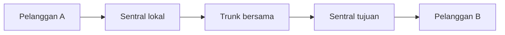

# Bab 4 — Jaringan Pensaklaran Sirkuit

> Pertanyaan utama: bagaimana banyak percakapan memakai jaringan telepon yang sama tanpa mencampur suara?

Urutan 4.1–4.8 mengikuti Bab 4 buku Leon-Garcia dan Widjaja. Dalam kontrak kuliah, inti Bab 4 dibahas pada pertemuan 5. Paket Sensei tidak memuat slide Bab 4 khusus; penjelasan ini merujuk isi buku dan subpokok kontrak. Beberapa angka SONET, PSTN, dan seluler di sini menggambarkan teknologi pada masa terbit buku, bukan spesifikasi semua jaringan sekarang.

**Gagasan dasar:** sebelum suara berjalan, jaringan memilih lintasan dan menyediakan kapasitas yang dibutuhkan selama panggilan. Pensinyalan menyiapkan dan membubarkan panggilan; transmisi membawa suaranya. *Multiplexing* membuat banyak sirkuit logis berbagi satu trunk fisik.

## 4.1 Multiplexing

Multiplexing menggabungkan beberapa aliran ke satu media; *demultiplexer* memisahkannya kembali. Ia tidak sama dengan switching: multiplexing menjawab “bagaimana berbagi media?”, switching menjawab “masukan mana disambung ke keluaran mana?”. Jika empat suara PCM masing-masing 64 kb/s digabung tanpa overhead, laju gabungan minimal 256 kb/s. Protokol nyata memerlukan tambahan pembingkaian.

### 4.1.1 FDM — pembagian frekuensi

Setiap percakapan mendapat rentang frekuensi berbeda pada saat yang sama. Radio adalah analogi: beberapa siaran hidup bersamaan tetapi setiap penerima menyetel kanal tertentu. Antarkan satu kanal dan kanal berikutnya sering diberi *guard band* agar tidak saling bocor. Contoh buatan: tiga kanal masing-masing 4 kHz dengan dua celah 1 kHz memerlukan setidaknya `3×4 + 2×1 = 14 kHz`, sebelum batas teknis lain.

### 4.1.2 TDM — pembagian waktu

Setiap sumber mendapat giliran pada slot waktu yang berulang. TDM sinkron menyisihkan slot meski sumber sedang diam; penerima tahu slot mana milik siapa dari posisi dalam frame. Bila 8 sumber masing-masing memberi 1 byte tiap 125 mikrodetik, muatan per frame 8 byte dan laju muatan `8 × 8 × 8.000 = 512 kb/s`. Slot kosong bisa memboroskan kapasitas; TDM statistik mengisi giliran menurut lalu lintas aktual dan perlu identitas tujuan serta penyangga.

### 4.1.3 WDM — pembagian panjang gelombang

WDM adalah bentuk pembagian frekuensi pada serat optik: beberapa warna/panjang gelombang cahaya berjalan dalam satu serat. Tiap panjang gelombang dapat membawa aliran sendiri. Banyak kanal optik meningkatkan kapasitas serat, tetapi pemancar, penerima, pemisahan warna, dan penguat tetap menentukan batas sistem.

## 4.2 SONET

SONET adalah standar transport optik sinkron. Tujuannya menyatukan laju dan format frame agar aliran dari peralatan berbeda dapat digabung dan dipecah, serta memberi fasilitas pemantauan dan pemulihan gangguan. Nilai dasar yang sering dijumpai ialah **STS-1/OC-1 51,84 Mb/s**; OC menyebut sinyal optiknya, STS sinyal listrik/logis. Jangan anggap seluruh laju itu muatan pelanggan.

### 4.2.1 Multiplexing SONET

Aliran kecepatan rendah dapat ditempatkan ke wadah logis, lalu digabung menjadi aliran lebih cepat. SONET sinkron berarti waktu frame selaras, tetapi *pointer* membantu ketika posisi muatan bergeser sedikit akibat perbedaan jam. Contoh: STS-3 mempunyai laju nominal `3 × 51,84 = 155,52 Mb/s` sebelum memperhitungkan overhead.

### 4.2.2 Struktur frame SONET

Frame STS-1 berupa **9 baris × 90 kolom byte** dan berulang **8.000 kali/detik**. Laju totalnya `9 × 90 × 8 × 8.000 = 51.840.000 b/s`. Sebagian byte adalah overhead bagian/saluran, bukan data pengguna. Bayangkan lembar tabel yang dikirim 8.000 kali tiap detik; posisi sel memberi arti pada setiap byte.

## 4.3 Jaringan transport

Jaringan transport membawa banyak aliran di antara sentral atau titik jaringan. Ia berbeda dari aplikasi pelanggan: pelanggan meminta panggilan, sedangkan jaringan transport menyediakan jalur berkapasitas tinggi di dalam jaringan.

### 4.3.1 Jaringan SONET

Topologi **ring** menghubungkan node dalam lingkaran. Jika satu ruas putus, rancangan proteksi dapat mengalihkan aliran ke arah lain, asalkan kapasitas cadangan tersedia. *UPSR* dan *BLSR* adalah contoh mekanisme proteksi ring dalam buku; keduanya berbeda dalam cara menyalin/mengalihkan lalu lintas. Proteksi bukan berarti semua jenis kerusakan otomatis tertangani.

### 4.3.2 Jaringan transport optik

Transport optik dapat membawa beberapa panjang gelombang dalam satu serat. Perangkat *add/drop* mengambil atau menyisipkan kanal tertentu di suatu node tanpa harus mengubah semua kanal menjadi data elektronik. Perutean optik dapat mengubah jalur sebuah panjang gelombang; syarat panjang gelombang dan ketersediaan port tetap perlu dihitung.

## 4.4 Saklar sirkuit

Saklar menyambungkan saluran masukan dan keluaran untuk panggilan. **Blocking** berarti panggilan baru tidak mendapat lintasan/sumber daya saat itu, meskipun pemanggil dan tujuan ada. Ini wajar pada rancangan kapasitas terbatas; jumlah kapasitas dipilih menurut biaya dan lalu lintas.

### 4.4.1 Saklar pembagian ruang

Pada *space-division switch*, titik sambung fisik/elektronik memilih jalur dari input ke output. Crossbar `N × M` secara konsep mempunyai hingga `N×M` titik silang, sehingga besar jaringan membutuhkan rancangan bertingkat untuk menghemat sumber daya. Dua panggilan dapat berlangsung bersamaan jika tidak berebut sambungan yang sama.

### 4.4.2 Saklar pembagian waktu

Pada *time-division switch*, sampel dari slot input disimpan lalu dikeluarkan pada slot output yang dipilih. Jika suara A masuk slot 2 dan harus keluar slot 6, memori/buffer menahan sampelnya sampai slot 6. **TDM** membagi media menurut waktu; **saklar waktu** mengubah hubungan antara slot masuk dan slot keluar.

## 4.5 Jaringan telepon

PSTN historis menghubungkan pelanggan ke **sentral lokal** lewat *local loop*, lalu sentral-sentral lewat *trunk*. Nomor tujuan dibaca pada saat menyiapkan panggilan. Setelah jalur tersambung, percakapan berjalan dua arah dan kapasitas disediakan sampai panggilan ditutup. Pada panggilan sibuk, sumber daya atau tujuan tidak tersedia; jaringan mengembalikan indikasi yang sesuai.

### 4.5.1 Sarana transmisi

Saluran pelanggan tradisional dapat berupa pasangan tembaga. Di dalam jaringan, suara dapat didigitalkan dengan PCM lalu beberapa kanal digabung dengan TDM pada trunk. Karena itu “telepon memakai circuit switching” tidak berarti suaranya selalu analog sepanjang jalan. Sentral, trunk, dan media akses dapat memakai teknologi berbeda.

### 4.5.2 Layanan digital ujung-ke-ujung

ISDN dalam pembahasan historis buku berupaya menyediakan kanal suara/data digital hingga sisi pelanggan. B-channel lazimnya 64 kb/s untuk muatan, sedangkan D-channel dipakai pensinyalan (dan layanan data tertentu). Kuncinya ialah memisahkan kapasitas pembawa dari informasi kendali panggilan.

## 4.6 Pensinyalan

Pensinyalan adalah pertukaran informasi untuk mendirikan, mengawasi, dan mengakhiri panggilan. Urutannya dapat dibayangkan: angkat telepon → terima tanda siap → kirim nomor → jaringan mencari rute dan sumber daya → tujuan berdering → penerima menjawab → suara mengalir → salah satu menutup → sumber daya dilepas. **Setup** memerlukan waktu; setelah berhasil, aliran suara tidak perlu memilih rute baru per sampel.

### 4.6.1 Pensinyalan jaringan telepon

Tanda kendali dapat berjalan di jalur yang sama dengan suara (*in-band*) atau lewat jalur kendali terpisah (*out-of-band*). Pemisahan memudahkan pengaturan panggilan dan layanan tambahan. Contoh pesan kendali: permintaan panggilan, tujuan sibuk, jawaban diterima, atau panggilan selesai.

### 4.6.2 Arsitektur SS7

SS7 adalah keluarga protokol pensinyalan di jaringan telepon. Jaringan titik pensinyalan menukar pesan kendali untuk routing panggilan dan layanan lain; jalur suara tidak harus mengikuti jalur pensinyalannya. Istilah yang sering muncul: **SSP** (sentral yang memulai/menangani layanan), **STP** (penerus pesan pensinyalan), dan **SCP** (logika/data layanan). Ini gambaran arsitektur historis; tidak perlu menghafal bahwa semua jaringan modern masih memakai susunan identik.

## 4.7 Trafik dan kendali beban berlebih (pilihan)

**Trafik yang ditawarkan** dapat dinyatakan dalam erlang: satu sirkuit dipakai terus selama periode pengamatan = 1 erlang. Contoh 30 panggilan selama satu jam, masing-masing rata-rata 2 menit, memberi `30 × 2/60 = 1 erlang` rata-rata. Satu erlang bukan “satu panggilan”; ia ukuran rata-rata pemakaian. Saat permintaan melebihi sumber daya, sebagian panggilan menunggu atau ditolak.

### 4.7.1 Konsentrasi

Lebih banyak pelanggan daripada trunk dapat dilayani bila tidak semuanya menelepon bersamaan. Contoh 100 pelanggan memakai 20 trunk berdasarkan perkiraan lalu lintas. Ini **konsentrasi**; jika 21 pelanggan membutuhkan trunk pada saat bersamaan, setidaknya satu tidak mendapat trunk bebas.

### 4.7.2 Kendali perutean

Jaringan dapat memilih rute utama lalu rute alternatif ketika trunk utama sibuk. Rute alternatif menolong selama masih ada kapasitas; pengalihan tanpa batas dapat memperparah kemacetan di tempat lain.

### 4.7.3 Kendali overload

Ketika panggilan datang terlalu cepat, sentral dapat membatasi percobaan baru, memprioritaskan kelas tertentu, atau mengembalikan tanda sibuk. Tujuannya menjaga panggilan yang sudah berjalan dan mencegah beban kendali melumpuhkan jaringan. Ini berbeda dari galat bit pada media transmisi.

## 4.8 Jaringan telepon seluler

Wilayah dibagi menjadi **sel** dengan stasiun basis. Ponsel memakai kanal radio ke stasiun basis, lalu jaringan meneruskan panggilan. Saat ponsel bergerak, **handoff/handover** memindahkan hubungan ke sel berikutnya agar panggilan tidak terputus. Sel yang berjauhan dapat memakai ulang frekuensi; sel berdekatan harus mengelola interferensi. **Roaming** berarti layanan saat berada di jaringan/wilayah lain sesuai kesepakatan, bukan sinonim handoff. Teknologi seluler kini banyak membawa suara sebagai paket, jadi penjelasan sirkuit di buku bersifat historis.

## Kamus cepat

| Istilah | Arti praktis |
|---|---|
| Sirkuit | Jalur logis dengan sumber daya yang disediakan selama hubungan |
| Trunk | Sambungan berkapasitas bersama antarsentral/perangkat |
| FDM/TDM/WDM | Berbagi media menurut frekuensi/waktu/panjang gelombang |
| Switching | Memilih hubungan input dan output |
| Pensinyalan | Pesan kendali untuk mengatur hubungan |
| Blocking | Hubungan baru gagal mendapat sumber daya saat itu |
| Proteksi ring | Mengalihkan aliran ketika ruas tertentu rusak |

## Latihan dan pembahasan

1. **Bedakan TDM dan switching waktu.** TDM memberi giliran sumber pada satu media; switching waktu memetakan slot masuk ke slot keluar yang berbeda.
2. **Empat aliran PCM 64 kb/s digabung. Berapa muatan minimal?** `4×64 = 256 kb/s`, belum termasuk overhead.
3. **Hitung laju STS-1 dari 9×90 byte setiap 125 mikrodetik.** `9×90×8×8.000 = 51,84 Mb/s`.
4. **Mengapa panggilan bisa gagal padahal nomor benar?** Rute atau trunk yang diperlukan dapat penuh (*blocking*), atau tujuan sibuk.
5. **Apa beda pensinyalan dan jalur suara?** Yang pertama mengatur panggilan; yang kedua membawa informasi pengguna setelah hubungan dibentuk.
6. **30 panggilan/jam masing-masing 2 menit: berapa erlang?** `30×2/60 = 1 erlang`.
7. **Mengapa frekuensi seluler dapat dipakai ulang?** Sel yang cukup berjauhan memiliki interferensi yang dapat dijaga di bawah batas rancangan.

## Asal dan cakupan

Rujukan: *Communication Networks*, edisi kedua, Bab 4, serta kontrak kuliah pertemuan 5. Bagian 4.7 bertanda pilihan di daftar isi buku. Paket materi yang Sensei kirim tidak memuat slide kuliah Bab 4 khusus.
