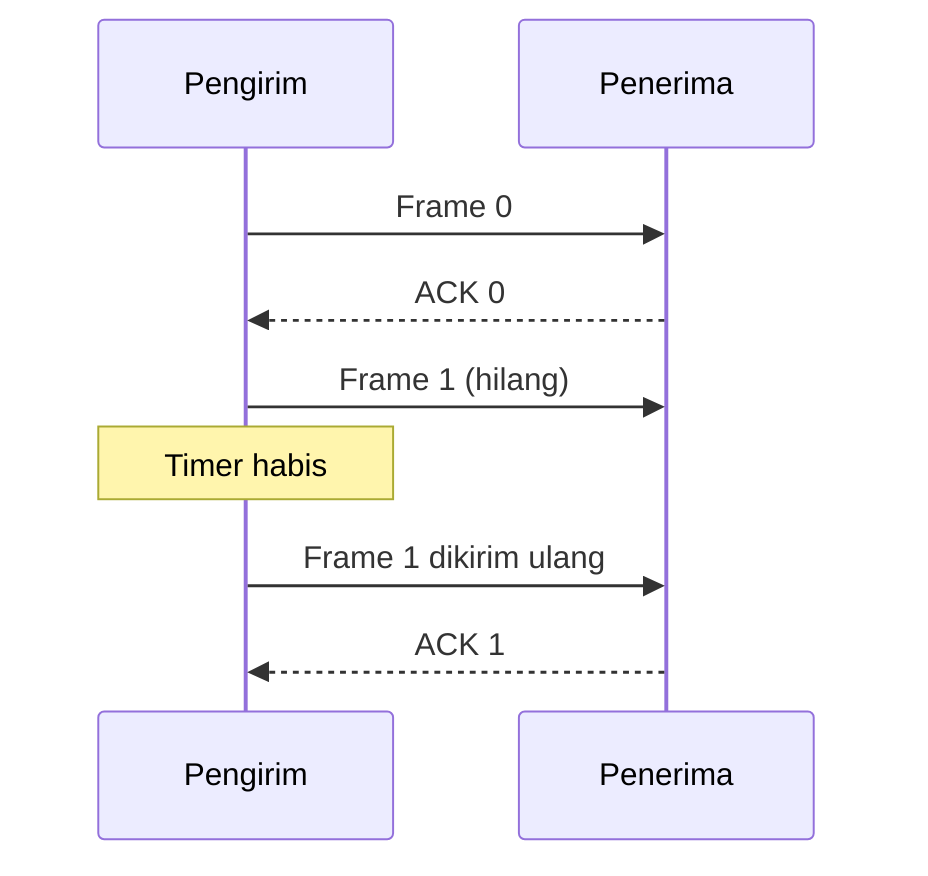

# Bab 5 — Protokol Antartitik dan Data Link

> Pertanyaan utama: jika satu frame rusak atau hilang, bagaimana pengirim dan penerima tetap sepakat tentang data yang benar?

Urutan 5.1–5.7 mengikuti buku. Kontrak kuliah menempatkan pokok bahasan ini pada pertemuan 6; slide Bab 5 dalam paket Sensei berjumlah 148 halaman. Semua contoh memakai nomor urut dan waktu sederhana agar mekanismenya terlihat.

## 5.1 Protokol antartitik dan model layanan

Dua entitas setingkat di ujung suatu hubungan memakai **protokol**: aturan format frame, nomor urut, respons, dan waktu tunggu. Protokol dapat memberi layanan kepada lapisan di atasnya. *Peer-to-peer* di bab ini berarti entitas protokol setingkat yang berkomunikasi secara logis; tidak selalu berarti aplikasi berbagi berkas P2P.

### 5.1.1 Model layanan

Layanan dapat **tanpa koneksi** (setiap unit dikirim sendiri) atau **berorientasi koneksi** (ada pembentukan keadaan hubungan). Ia juga bisa **tidak diakui** (tanpa ACK per unit) atau **diakui** (penerima memberi ACK dan pengirim dapat mengirim ulang). “Tanpa ACK” tidak berarti selalu salah; misalnya data real-time tertentu lebih memilih melewatkan sampel terlambat.

### 5.1.2 Contoh layanan

Berikut empat pertanyaan yang membantu: apakah urutan dijaga? Apakah data hilang dikirim ulang? Apakah ada batas delay? Apakah batas unit data dipertahankan? Aliran byte andal seperti TCP mempertahankan urutan byte, tetapi **tidak mempertahankan batas pesan aplikasi**. Layanan datagram mempertahankan batas paket tetapi tidak otomatis menjamin kedatangannya.

### 5.1.3 Ujung-ke-ujung versus per-hop

**Hop-by-hop** memeriksa/mengirim ulang pada satu sambungan tetangga, sehingga kesalahan radio dapat diperbaiki dekat tempat terjadinya. **End-to-end** memeriksa dari pengirim akhir ke penerima akhir. Keduanya dapat dipakai bersama: keberhasilan di satu hop belum menjamin data sampai ke aplikasi tujuan, karena kesalahan masih mungkin terjadi di bagian lain.

## 5.2 ARQ dan pengiriman andal

*Automatic Repeat reQuest* (ARQ) menggabungkan deteksi galat, ACK/NAK, nomor urut, timer, dan retransmisi. Jika ACK hilang, pengirim dapat mengulang frame yang sebenarnya sudah diterima. Karena itu penerima harus mengenali **duplikat** dengan nomor urut. NAK dapat mempercepat ulang, tetapi timer tetap diperlukan saat pesan kendali juga hilang.

### 5.2.1 Stop-and-Wait ARQ

Pengirim mengirim **satu** frame, lalu menunggu ACK sebelum frame berikutnya. Nomor urut 0 dan 1 cukup untuk membedakan frame baru dari ulangan selama hanya satu frame outstanding dan aturan protokol sesuai. Contoh: frame 0 tiba, ACK-nya hilang, timer pengirim habis; frame 0 dikirim ulang. Penerima mengenali 0 sebagai duplikat, tidak menyerahkan isinya dua kali, tetapi mengirim ACK lagi.

Efisiensi tanpa galat dapat diperkirakan `T_frame / (T_frame + 2T_prop + T_ACK)`, bila waktu pemrosesan diabaikan. Misal frame butuh 1 ms untuk dikirim, rambat satu arah 5 ms, ACK sangat singkat: efisiensi kira-kira `1/(1+10) = 9,1%`. Kanal banyak menganggur saat menunggu.

### 5.2.2 Go-Back-N ARQ

Pengirim boleh mengirim sampai `W` frame sebelum menunggu ACK; ini **sliding window**. Penerima Go-Back-N menerima frame sesuai urutan dan membuang frame sesudah celah. Jika frame 2 hilang tetapi 3 dan 4 tiba, pengirim akhirnya mengulang **2, 3, dan 4**. ACK kumulatif menyatakan semua frame sebelum batas tertentu sudah diterima; arti nomor ACK harus ditetapkan oleh protokol yang dipakai. Dengan ruang nomor urut berukuran `2^m`, jendela pengirim lazim dibatasi `W ≤ 2^m - 1` agar frame lama dan baru tidak ambigu.

### 5.2.3 Selective Repeat ARQ

Penerima boleh menyimpan frame yang datang di luar urutan. Jika frame 2 hilang tetapi 3 dan 4 datang, hanya **2** yang perlu dikirim ulang; setelah 2 tiba, 2–4 dapat diserahkan berurutan. Ini menghemat ulang pada kanal dengan galat, tetapi perlu buffer dan ACK per frame. Agar nomor urut yang berputar tidak membingungkan frame lama dan baru, ukuran jendela lazimnya `W ≤ 2^(m-1)` ketika jendela pengirim dan penerima sama.

| Sifat | Stop-and-Wait | Go-Back-N | Selective Repeat |
|---|---|---|---|
| Frame outstanding | 1 | Beberapa | Beberapa |
| Frame di luar urutan | Tidak ada | Dibuang | Disimpan sementara |
| Saat satu frame hilang | Ulang satu | Ulang frame hilang dan sesudahnya | Ulang yang hilang |
| Kebutuhan buffer | Rendah | Rendah di penerima | Lebih tinggi di penerima |

## 5.3 Protokol antartitik lainnya

### 5.3.1 Kendali aliran sliding window

**Flow control** mencegah pengirim membanjiri buffer penerima; **error control** menangani data rusak/hilang; **congestion control** mencegah jaringan di tengah kelebihan beban. Walau semuanya bisa membatasi laju, penyebabnya berbeda. Penerima dapat mengiklankan ruang buffer yang masih tersedia. Bila jendela penerima nol, pengirim menahan data baru sampai tersedia ruang lagi.

### 5.3.2 Pemulihan waktu untuk layanan sinkron

Aliran sinkron perlu mempertahankan irama keluaran, bukan sekadar jumlah data. Jam pengirim dan penerima dapat sedikit berbeda. Penerima memakai informasi waktu, buffer, atau penyesuaian laju untuk mencegah buffer kosong/penuh. Ini penting pada suara: sampel yang datang lengkap tetapi terlalu terlambat dapat tidak berguna untuk pemutaran langsung.

### 5.3.3 Layanan aliran andal TCP dan flow control

TCP memberi nomor pada **byte**, bukan pada pesan aplikasi. ACK kumulatif menyatakan byte berurutan berikutnya yang diharapkan. TCP memakai retransmisi untuk keandalan, jendela penerima untuk flow control, dan mekanisme terpisah untuk mengelola kemacetan. Contoh: ACK 1001 berarti byte sampai 1000 telah diterima berurutan menurut konvensi TCP. Satu pemanggilan `send` tidak menjamin satu pemanggilan `recv` yang sama panjang.

## 5.4 Framing

Aliran bit harus dibagi menjadi unit yang jelas batasnya, yaitu **frame**. Pilihan mekanisme: panjang frame eksplisit, byte khusus pembatas ditambah *byte stuffing*, atau pola bit khusus ditambah *bit stuffing*. Pada bit stuffing, pengirim menyisipkan 0 setelah lima angka 1 berturut-turut di bagian data agar pola bendera `01111110` tidak muncul secara tidak sengaja. Penerima membuang 0 sisipan setelah mengenali aturan itu. Framing tidak sama dengan deteksi galat; banyak frame juga memuat CRC.

## 5.5 PPP — Point-to-Point Protocol

PPP membungkus paket pada sambungan antardua ujung. **LCP** menyiapkan dan menguji parameter hubungan; **NCP** menyiapkan protokol lapisan jaringan tertentu, misalnya IP. Frame PPP mempunyai tanda batas, bidang protokol yang menunjukkan muatan, data, dan pemeriksa frame. PPP menjelaskan cara membawa paket serta negosiasi sambungan, tetapi tidak dengan sendirinya menjamin paket tiba tanpa kesalahan melalui ARQ.

## 5.6 HDLC — High-Level Data Link Control

### 5.6.1 Layanan data link

HDLC menyediakan framing, deteksi kesalahan, dan pada mode tertentu kendali urutan/aliran untuk hubungan data link. **Lapisan data link** bekerja di satu sambungan; keberhasilan HDLC di sana tidak sama dengan jaminan seluruh rute end-to-end.

### 5.6.2 Konfigurasi dan mode transfer

Konfigurasi menentukan peran stasiun utama/sekunder atau gabungan. Mode transfer menentukan siapa boleh mulai mengirim dan kapan. Istilah *normal response mode* dan *asynchronous balanced mode* menggambarkan aturan giliran/peran yang berbeda, bukan kecepatan bit tertentu.

### 5.6.3 Format frame HDLC

Frame umumnya memuat **flag**, alamat, kendali, informasi bila ada, dan **FCS**. Flag `01111110` membatasi frame. *Control field* memuat jenis frame dan nomor urut/ACK sesuai mode; FCS mendeteksi galat. HDLC memakai bit stuffing agar flag di dalam informasi tidak disalahartikan sebagai akhir frame.

### 5.6.4 Contoh pertukaran frame

Satu pihak dapat mengirim *information frame* bernomor, penerima membalas dengan *supervisory frame* untuk mengakui atau meminta ulang, dan *unnumbered frame* menangani kendali hubungan. Contoh urutan sederhana: siapkan sambungan → kirim I(0) → terima ACK → kirim I(1) → tutup. Nomor dan format detail bergantung mode HDLC.

## 5.7 Berbagi link dengan multiplexer paket (pilihan)

### 5.7.1 Multiplexing statistik

Beberapa sumber berbagi satu link sesuai kebutuhan saat itu. Jika sumber A diam, B dapat memakai kapasitasnya. Ini lebih hemat untuk trafik yang datang berselang-seling dibanding slot tetap, tetapi menimbulkan **antrian** saat beberapa sumber aktif bersamaan. Contoh: link 10 Mb/s menerima tiga aliran 4 Mb/s serentak; total 12 Mb/s, maka antrian bertambah selama kondisi itu berlangsung, meski rata-rata harian rendah.

### 5.7.2 *Speech interpolation* dan suara berpakat

Percakapan mempunyai jeda ketika seseorang diam. Sistem dapat hanya mengirim paket saat ada aktivitas bicara dan membagi kapasitas ke lebih banyak pengguna. Penghematannya dibayar dengan kebutuhan mendeteksi aktivitas, menahan jitter, dan mengelola lonjakan ketika banyak orang bicara bersamaan.

## Kamus cepat

| Istilah | Arti |
|---|---|
| ACK/NAK | Pengakuan berhasil / pemberitahuan masalah |
| Timeout | Batas tunggu sebelum pengirim mengambil tindakan, sering mengirim ulang |
| Sequence number | Penanda urutan untuk membedakan data baru, hilang, dan duplikat |
| Sliding window | Batas data yang boleh dikirim sebelum mendapat ACK |
| Framing | Menentukan batas unit data pada aliran bit |
| FCS/CRC | Bit pemeriksa kesalahan dalam frame |
| Flow control | Mengikuti kapasitas penerima |
| Congestion control | Mengikuti kapasitas jaringan di tengah |

## Latihan dan pembahasan

1. **ACK hilang setelah frame tiba. Apa bahayanya?** Pengirim mengulang dan penerima bisa menerima duplikat; nomor urut serta ACK ulang mencegah penyerahan data dua kali.
2. **Dalam Go-Back-N, frame 2 hilang tetapi 3–4 tiba. Apa yang diulang?** Mulai frame 2 dan semua frame sesudahnya yang belum diakui, termasuk 3–4.
3. **Dalam Selective Repeat, kasus yang sama?** Penerima menyimpan 3–4 dan pengirim cukup mengulang 2, jika buffer dan ACK bekerja sesuai aturan.
4. **Mengapa Stop-and-Wait kurang efisien di link berjarak jauh?** Pengirim menunggu kira-kira satu RTT setelah setiap frame; kanal menganggur selama menunggu.
5. **Untuk nomor urut 3 bit, berapa jendela maksimum Go-Back-N dan Selective Repeat yang umum?** `2^3−1 = 7` dan `2^(3−1) = 4`.
6. **Apa beda framing dan CRC?** Framing menunjukkan awal/akhir frame; CRC memeriksa apakah isi bit frame berubah.
7. **Apakah TCP mempertahankan batas pesan aplikasi?** Tidak; TCP mengirim aliran byte berurutan. Aplikasi harus membentuk batas sendiri.

## Asal dan cakupan

Rujukan: *Communication Networks*, edisi kedua, Bab 5; `Garcia-2003_ch5-Digital Transmission Fundamentals.pdf` (judul nama berkas tidak sesuai isi: halaman pembuka menyebut Bab 5 *Peer-to-Peer Protocols*); dan kontrak kuliah pertemuan 6. Bagian 5.7 bertanda pilihan di daftar isi buku.
