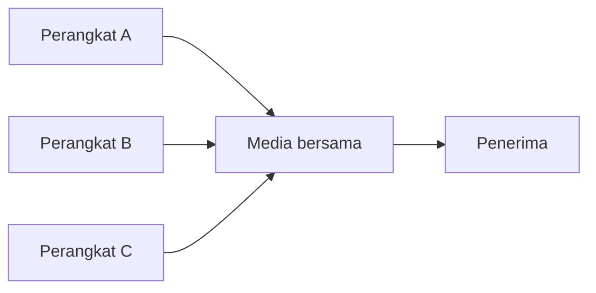

# Bab 6 — Akses Media dan Jaringan Lokal

> Pertanyaan utama: bila banyak perangkat memakai satu media, siapa boleh mengirim dan apa yang terjadi jika mereka mengirim bersamaan?

Urutan 6.1–6.11 mengikuti buku Leon-Garcia dan Widjaja; kontrak kuliah menempatkan intinya pada pertemuan 7. Slide Bab 6 dalam paket Sensei berjumlah 203 halaman. Contoh Ethernet koaksial, token ring, dan FDDI adalah arsitektur historis yang berguna untuk memahami mekanisme; jangan mengira semuanya masih lazim dipasang.

## 6.1 Komunikasi akses jamak

Jika beberapa pengirim berbagi kanal siaran (*broadcast channel*), jaringan perlu **medium access control** (MAC) untuk menentukan giliran. Pada media kabel bersama, dua sinyal serentak dapat bertabrakan; pada radio, sinyal juga bisa saling mengganggu meski pengirim tidak saling mendengar. Metode utama: **acak** (kirim ketika mungkin), **terjadwal** (giliran diatur), dan **channelization** (bagi kanal menjadi bagian frekuensi/waktu/kode). **Alamat MAC** menunjukkan antarmuka tujuan pada satu lingkungan link; ia berbeda dari sublapisan kendali akses media yang kebetulan memakai singkatan sama.

## 6.2 Akses acak

Stasiun mencoba mengirim tanpa giliran tetap. Jika gagal karena tabrakan, ia menunggu waktu acak sebelum mencoba lagi. Tanpa penundaan acak, dua stasiun yang bertabrakan dapat selalu mengulang bersamaan. Kinerja bagus saat beban rendah; saat beban tinggi, tabrakan dan ulang dapat menghabiskan kapasitas.

### 6.2.1 ALOHA

*Pure ALOHA* mengizinkan kirim kapan saja. Jika satu frame berdurasi `T`, kiriman lain yang mulai dalam rentang kira-kira `2T` dapat menabraknya: periode rawan tabrakan = `2T`. Dengan asumsi model trafik Poisson buku, throughput ternormalisasi `S = G e^(-2G)` dan maksimum sekitar `1/(2e) ≈ 18,4%` pada `G = 0,5`. Angka ini milik model ideal, bukan kapasitas semua jaringan radio.

### 6.2.2 Slotted ALOHA

Pengirim hanya mulai pada batas slot. Periode rawan turun menjadi satu slot `T`; pada model yang sama `S = G e^(-G)` dan puncaknya `1/e ≈ 36,8%` di `G = 1`. Ia perlu sinkronisasi waktu, dan slot bisa kosong. Dua perangkat yang memilih slot sama tetap bertabrakan.

### 6.2.3 CSMA

*Carrier Sense Multiple Access*: dengarkan media sebelum mengirim. Jika sibuk, tunda menurut aturan persisten/non-persisten. Tabrakan masih mungkin, karena dua stasiun berjauhan dapat sama-sama mendengar “kosong” sebelum sinyal yang lain tiba. Semakin besar delay propagasi relatif terhadap durasi frame, semakin besar masalah itu.

### 6.2.4 CSMA/CD

Pada Ethernet media bersama historis, stasiun mendengarkan sambil mengirim; ketika mendeteksi tabrakan, ia berhenti, memberi sinyal *jam*, lalu menunggu waktu acak menurut **binary exponential backoff**. Agar tabrakan terdeteksi sebelum pengirim selesai, durasi frame minimum harus mencakup kira-kira perjalanan bolak-balik sinyal di diameter jaringan. Pada Ethernet switch full-duplex modern, tiap link point-to-point tidak menghadapi tabrakan bersama sehingga CSMA/CD tidak dipakai untuk pengiriman normal di link itu.

## 6.3 Penjadwalan akses media

### 6.3.1 Reservasi

Pengirim memesan giliran/slot lebih dulu, kemudian mengirim pada giliran yang disepakati. Cocok untuk beban teratur; saat hampir semua sumber diam, slot reservasi dan proses pemesanan bisa menjadi overhead.

### 6.3.2 Polling

Pengendali bertanya bergiliran kepada stasiun: “ada data?”. Tidak ada tabrakan pengirim yang patuh aturan, tetapi polling menambah pesan kendali dan pengendali bisa menjadi titik kegagalan. Jika A kosong dan B punya data, B tetap menunggu sampai giliran ditanya.

### 6.3.3 Token-passing ring

Sebuah **token** beredar; hanya pemegang token boleh mengirim. Waktu tunggu dapat lebih terkendali daripada akses acak pada beban tinggi. Token yang hilang atau ganda harus dipulihkan dengan aturan khusus. Ring di sini menggambarkan alur logis giliran, yang belum tentu sama dengan bentuk kabel fisik.

### 6.3.4 Perbandingan metode terjadwal

Reservasi memerlukan tahap mendaftar, polling memerlukan pengendali yang memanggil, token memerlukan token yang beredar. Ketiganya menghindari tabrakan normal melalui koordinasi, dengan biaya pesan kendali dan waktu tunggu.

### 6.3.5 Akses acak versus terjadwal

Pada beban ringan dan kiriman jarang, akses acak sering memberi delay kecil karena tidak menunggu giliran tetap. Pada beban tinggi, koordinasi dapat mengurangi tabrakan dan memberi batas waktu yang lebih jelas. Tidak ada satu pilihan yang selalu unggul; perhatikan trafik, ukuran jaringan, dan biaya koordinasi.

## 6.4 Channelization (pilihan)

### 6.4.1 FDMA

Pengguna mendapat pita frekuensi berbeda. Mereka dapat mengirim bersamaan, tetapi pita milik pengguna yang diam tidak otomatis terpakai pihak lain. *Guard band* mengurangi interferensi antarbagian.

### 6.4.2 TDMA

Pengguna berbagi frekuensi namun berbeda slot waktu. Perlu sinkronisasi dan kadang *guard time*. Berbeda dari TDM dalam Bab 4 hanya pada penekanan: TDMA membagi akses di antara pengirim yang berbeda, sedangkan TDM menjelaskan gabungan aliran pada satu jalur.

### 6.4.3 CDMA

Pengguna dapat berbagi waktu dan frekuensi tetapi memakai pola kode berbeda. Penerima mengorelasikan sinyal dengan kode yang dituju. Kode tidak berarti interferensi lenyap; kendali daya penting agar pengirim kuat tidak menenggelamkan pengirim lemah (*near-far problem*).

### 6.4.4 Pada jaringan seluler

Sel membagi sumber daya radio dan memakai ulang sumber daya di lokasi cukup jauh. Perencanaan harus menyeimbangkan kapasitas dengan interferensi. Teknologi seluler masa kini dapat memakai kombinasi teknik yang berbeda dari contoh historis buku.

## 6.5 Kinerja delay MAC/channelization (pilihan)

### 6.5.1 Trafik yang datang berselang-seling

Jika kanal dibagi tetap menjadi empat bagian tetapi hanya satu pengguna aktif, pengguna itu mungkin hanya memperoleh seperempat kapasitas. Akses statistik dapat memakai seluruh kapasitas ketika yang lain diam, tetapi membutuhkan buffer saat beberapa pengguna aktif sekaligus.

### 6.5.2 Polling dan token ring

Delay memuat waktu menunggu giliran, waktu kendali, dan waktu mengirim. Jika ada `N` stasiun, waktu satu putaran giliran umumnya bertambah saat `N` naik. Batas praktis bergantung durasi kunjungan tiap stasiun dan ukuran frame, bukan hanya jumlah stasiun.

### 6.5.3 Akses acak dan CSMA/CD

Saat beban naik, lebih banyak percobaan bertemu dan mengulang; throughput bersih dapat turun meski laju fisik tetap. Parameter penting ialah rasio waktu propagasi terhadap waktu transmisi frame. Rumus ideal ALOHA tidak boleh dipakai begitu saja untuk CSMA/CD atau Wi-Fi.

## 6.6 Protokol LAN

LAN menghubungkan perangkat pada area terbatas. Frame LAN membawa alamat link, tipe/panjang sesuai format, muatan, serta pemeriksa galat. LAN menyediakan pengiriman *hop lokal*; pengiriman antarsubnet memerlukan fungsi jaringan seperti router.

### 6.6.1 Struktur LAN

Topologi fisik dapat bus, ring, atau bintang. Bintang dengan switch umum pada Ethernet modern. **Broadcast domain** adalah bagian jaringan yang menerima frame siaran tertentu; switch meneruskan broadcast dalam domain/VLAN yang sama, sedangkan router biasanya memisahkannya.

### 6.6.2 Sublapisan MAC

MAC menentukan akses media dan alamat link. Pada Ethernet, frame memakai alamat MAC sumber dan tujuan. Jika media dibagi bersama, MAC juga harus mengelola kemungkinan tabrakan. Saat antarmuka berkomunikasi lewat switch full-duplex, persoalan aksesnya berbeda.

### 6.6.3 Sublapisan LLC

*Logical Link Control* (LLC) memberi antarmuka logis di atas berbagai teknologi MAC dan dapat menandai layanan/protokol lapisan atas. Pembagian LLC/MAC adalah bagian arsitektur IEEE 802; tidak berarti semua frame Internet masa kini selalu menampilkan header LLC yang terpisah.

## 6.7 Ethernet dan IEEE 802.3

### 6.7.1 Protokol Ethernet

Ethernet lama memakai media bersama dan CSMA/CD. Ethernet switch modern menghubungkan tiap host lewat link terpisah, dapat full-duplex, dan switch memilih port keluar berdasarkan alamat MAC yang telah dipelajari. Switch belajar **alamat sumber** dari frame masuk. Jika tujuan belum dikenal, ia dapat *flood* ke port lain dalam VLAN terkait; setelah tujuan menjawab, tabel alamatnya terisi.

### 6.7.2 Struktur frame

Preamble membantu sinkronisasi; alamat tujuan dan sumber masing-masing 6 byte; bidang tipe/panjang menunjukkan muatan atau panjang menurut format; FCS biasanya CRC-32. Muatan Ethernet standar umumnya 46–1500 byte, dengan padding bila terlalu pendek. Frame Ethernet klasik memiliki panjang minimum 64 byte dari alamat tujuan sampai FCS, **tanpa** menghitung preamble. Angka minimum historis terkait deteksi tabrakan; jangan campur dengan ukuran IP packet atau overhead fisik.

### 6.7.3 Lapisan fisik

Nama 10BASE-T, 100BASE-TX, dan lain-lain menyatakan keluarga laju/media. Kawat berpilin, serat, dan jarak maksimum bergantung standar spesifik. Tidak semua port Ethernet memakai jenis kabel atau jarak sama.

### 6.7.4 Fast Ethernet

Fast Ethernet memberi laju nominal 100 Mb/s dan mempertahankan bentuk layanan/frame Ethernet agar jaringan dapat dikembangkan. Switch membantu memisahkan trafik tiap link; laju 100 Mb/s adalah laju link nominal, bukan jaminan aplikasi menerima 100 Mb/s bersih.

### 6.7.5 Gigabit Ethernet

Gigabit Ethernet memberi 1 Gb/s nominal. Teknologi fisik dan penanganan mode half/full duplex berbeda menurut varian. Pada praktik switch full-duplex, collision domain bersama tidak lagi menjadi mekanisme utama.

### 6.7.6 10 Gigabit Ethernet

10 Gb/s menggunakan operasi full-duplex point-to-point pada standar yang dibahas buku; tidak mengandalkan CSMA/CD. Yang tetap sama ialah format/konsep layanan Ethernet, sementara lapisan fisik dan kapasitas berubah.

## 6.8 Token Ring / IEEE 802.5

### 6.8.1 Protokol

Token beredar secara logis. Pemegang token dapat mengirim frame; frame berjalan melalui stasiun sampai kembali atau ditangani menurut aturan ring, lalu token dilepas kembali. Dibutuhkan mekanisme pengawas untuk token hilang, frame beredar tanpa akhir, dan kegagalan node.

### 6.8.2 Struktur frame

Frame membedakan token dan data serta memuat alamat dan kendali. Detail tanda awal/akhir, status, dan pemeriksaan galat berbeda dari Ethernet. Pokok perbandingan UTS biasanya **giliran teratur** versus **berebut medium**.

## 6.9 FDDI

*Fiber Distributed Data Interface* memakai ring serat optik dan token passing, dengan ring tambahan untuk ketahanan. Pada kegagalan tertentu, ring dapat dikonfigurasi ulang agar layanan berlanjut. FDDI adalah contoh penting rancangan LAN/backbone historis, bukan sinonim untuk semua jaringan serat optik.

## 6.10 WLAN / IEEE 802.11

Radio sulit memakai collision detection saat memancar: daya pancar sendiri menutupi sinyal lain. WLAN menggunakan keluarga **CSMA/CA**, yaitu mengurangi peluang tabrakan melalui dengar kanal, waktu tunggu, dan ACK link. Tabrakan tetap bisa terjadi.

### 6.10.1 Ad hoc dan infrastruktur

Dalam mode **infrastruktur**, perangkat berhubungan melalui access point (AP); AP menghubungkan ke jaringan distribusi. Dalam mode **ad hoc**, perangkat dapat saling berkomunikasi tanpa AP dalam kelompok yang sesuai. AP bukan router secara otomatis, walau perangkat rumahan sering menggabungkan kedua fungsi.

### 6.10.2 Struktur frame dan pengalamatan

Frame 802.11 dapat memuat beberapa alamat karena pengirim radio, penerima radio, sumber akhir, dan tujuan akhir dapat berbeda ketika AP meneruskan frame. Inilah alasan frame Wi-Fi tidak selalu memakai tepat dua alamat seperti gambaran sederhana Ethernet.

### 6.10.3 Kendali akses media

Pengirim mendengar kanal, menunggu periode tertentu, lalu memilih *random backoff* ketika perlu. ACK link membantu mendeteksi frame yang tidak diterima; pengirim dapat mengulang. **Hidden terminal:** A dan C tidak saling mendengar, tetapi keduanya dapat menabrak di B. RTS/CTS opsional membantu pada beberapa keadaan dengan memesan medium secara singkat, dengan overhead tambahan.

### 6.10.4 Lapisan fisik (pilihan)

Standar 802.11 memiliki beberapa generasi modulasi, pita, lebar kanal, dan laju. Laju “teoretis” fisik bukan throughput aplikasi; overhead frame, persaingan medium, interferensi, jarak, dan kemampuan perangkat turut menentukan.

## 6.11 Bridge dan Ethernet switch

Bridge/switch menghubungkan segmen LAN pada lapisan link. Ia meneruskan frame menurut alamat MAC, bukan menghitung rute IP seperti router. Jika banyak switch membentuk siklus, frame broadcast dapat terus beredar; karena itu diperlukan mekanisme pencegah loop.

### 6.11.1 Transparent bridge

Bridge belajar alamat sumber tanpa konfigurasi setiap host. Algoritme *spanning tree* memilih root, menentukan port yang meneruskan, dan menahan port lain agar topologi aktif tidak bersiklus. Jalur cadangan dapat aktif ketika topologi berubah. Flooding pada alamat yang belum dikenal adalah tindakan sementara, bukan rute permanen.

### 6.11.2 Source-routing bridge

Pada pendekatan ini, pengirim memasukkan informasi lintasan bridge ke frame. Hal ini memindahkan sebagian keputusan rute ke pihak pengirim dan membutuhkan mekanisme menemukan lintasan. Ia berbeda dari transparent bridge yang belajar dan memilih berdasarkan tabel lokal.

### 6.11.3 Bridge media campuran

Menghubungkan jenis LAN yang berbeda menuntut penyesuaian format, ukuran frame, dan sifat layanan. Bridge tidak bisa secara ajaib mengubah setiap fitur media menjadi identik; paket terlalu besar atau format yang tidak cocok dapat membutuhkan penanganan khusus.

### 6.11.4 VLAN

VLAN membagi satu infrastruktur switch menjadi beberapa domain link logis. Perangkat dalam VLAN berbeda perlu fungsi lapisan jaringan untuk berkomunikasi. Tag IEEE 802.1Q membawa identitas VLAN pada link yang membawanya; port ke perangkat akhir bisa dikonfigurasi agar perangkat itu tidak perlu melihat tag.

## Latihan dan pembahasan

1. **Mengapa CSMA masih dapat bertabrakan walau mendengar sebelum kirim?** Sinyal dari pengirim lain memerlukan waktu rambat; dua pihak bisa melihat medium kosong hampir bersamaan.
2. **Bandingkan puncak throughput pure dan slotted ALOHA pada model ideal.** Sekitar 18,4% dan 36,8%; slot mengurangi periode rawan menjadi separuh.
3. **Mengapa CSMA/CD tidak dipakai pada link switch full-duplex?** Kedua arah punya jalur sendiri dan tidak berbagi media yang dapat saling bertabrakan.
4. **Apa yang dilakukan switch saat belum mengenal alamat tujuan?** Flood ke port lain dalam VLAN terkait, kecuali port masuk, lalu belajar dari alamat sumber balasan.
5. **A dan C tidak saling mendengar tetapi sama-sama menuju B. Apa istilahnya?** Hidden terminal.
6. **Mengapa loop antar-switch berbahaya?** Frame broadcast/unknown dapat berputar dan berlipat; spanning tree menghilangkan siklus pada topologi aktif.
7. **Apakah VLAN berbeda dapat langsung bertukar frame hanya karena berada pada switch yang sama?** Tidak; biasanya perlu routing antar-VLAN.

## Asal dan cakupan

Rujukan: *Communication Networks*, edisi kedua, Bab 6; `Garcia-2003_ch6-Digital Transmission Fundamentals.pdf` (nama berkas tidak sesuai isi: slide pembuka menyebut Bab 6 *Medium Access Control Protocols and Local Area Networks*); dan kontrak kuliah pertemuan 7. Bagian 6.4, 6.5, serta 6.10.4 bertanda pilihan pada daftar isi buku.
