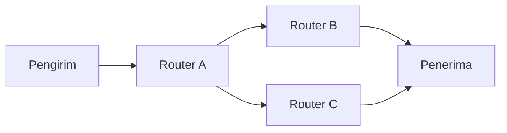

# Bab 7 — Jaringan Pensaklaran Paket

> Pertanyaan utama: bagaimana paket menemukan tujuan di jaringan yang punya banyak jalan dan banyak pengguna?

Urutan 7.1–7.9 mengikuti buku Leon-Garcia dan Widjaja. Kontrak kuliah menempatkan jaringan paket pada **pertemuan 9**, setelah UTS pada pertemuan 8; Sensei tetap meminta Bab 7 sehingga materi disertakan. Paket yang diunggah tidak memuat slide kuliah Bab 7 khusus. Angka dan contoh topologi di bawah adalah contoh belajar, bukan keadaan suatu jaringan nyata.

Pada **packet switching**, pesan panjang dipotong menjadi paket. Tiap paket membawa informasi kendali, masuk ke switch/router, menunggu bila jalur keluar sibuk, lalu diteruskan. Pengguna berbagi link secara statistik. Keuntungan utamanya adalah kapasitas tidak harus dipesan terus saat pengguna diam; akibatnya delay dan kehilangan paket dapat berubah saat antrian penuh.

## 7.1 Layanan jaringan dan operasi internal

Layanan ke pengguna dapat berorientasi koneksi atau tanpa koneksi, andal atau *best effort*. **Best effort** berarti jaringan berusaha mengantar paket tanpa menjamin delay, urutan, atau keberhasilan tertentu. Operasi internal bisa berbeda dari layanan yang terlihat: jaringan dapat mengatur jalur di dalam, sementara aplikasi hanya melihat pengiriman paket. Pemisahan penting: **forwarding** memindahkan satu paket menurut tabel yang sudah ada; **routing** membangun/memperbarui keputusan lintasan pada tabel tersebut.

Delay satu paket dapat diurai menjadi `pemrosesan + antrian + transmisi + propagasi` per hop. Contoh 1.000 byte pada link 1 Mb/s membutuhkan `8 ms` untuk masuk ke link; pada jarak 100 km dengan kecepatan rambat 2×10^8 m/s, propagasi sekitar `0,5 ms`. Antrian bisa nol atau jauh lebih besar, tergantung beban. Router menyimpan paket ketika keluaran belum bebas; buffer yang penuh menyebabkan *drop*.

## 7.2 Topologi jaringan paket

Node dihubungkan oleh link. Topologi **bintang** mudah dikelola tetapi pusat penting; **ring** menyediakan jalur sepanjang lingkaran; **mesh** memberi beberapa rute alternatif dengan biaya sambungan dan kendali lebih besar. **Derajat node** ialah jumlah link langsungnya. Topologi logis (hubungan yang digunakan protokol) bisa berbeda dari kabel fisik. Desain memperhitungkan kapasitas link, ketahanan jika gagal, lokasi trafik, dan biaya, bukan hanya jumlah hop terpendek.

**Contoh:** A–B–D punya dua link; A–C–D juga dua. Jika link B–D putus, jalur lewat C masih tersedia bila kapasitasnya cukup. Pada jaringan satu jalur A–B–D saja, putus B–D memisahkan D. Jalur alternatif meningkatkan ketahanan, tetapi router harus mengetahui perubahan topologi.

## 7.3 Datagram dan virtual circuit

| Sifat | Datagram | Virtual circuit (VC) |
|---|---|---|
| Sebelum data | Umumnya tanpa setup jalur | Menyiapkan jalur/keadaan lebih dulu |
| Keputusan di router | Tiap paket menurut alamat tujuan dan tabel saat itu | Menurut penanda VC dan tabel hubungan |
| Rute paket satu aliran | Dapat berubah | Biasanya tetap selama VC hidup |
| Kegagalan jalur | Paket berikut dapat mencari rute baru setelah tabel berubah | VC dapat perlu dibangun ulang/dialihkan |

“Virtual” berarti hubungan logis dalam jaringan paket, bukan kawat yang dipesan ujung-ke-ujung seperti sirkuit telepon klasik. VC dapat atau tidak dapat disertai jaminan sumber daya, menurut teknologinya.

### 7.3.1 Pensaklaran datagram tanpa koneksi

Paket membawa alamat tujuan. Pada setiap router, router melihat alamat dan memilih *next hop*. Dua paket dari pengirim yang sama dapat lewat rute berbeda dan tiba terbalik urutannya. Lapisan/aplikasi di ujung dapat mengurutkan kembali bila dibutuhkan. Contoh IP adalah layanan datagram, walau TCP di atasnya dapat memberi aliran byte andal.

### 7.3.2 Pensaklaran virtual circuit

Tahapnya: **setup** memilih rute dan memasang entri tabel pada setiap node; **transfer** membawa paket dengan identitas VC setempat; **teardown** melepas entri. Identitas VC dapat berbeda pada tiap link: router memetakan `(port masuk, label masuk)` menjadi `(port keluar, label keluar)`. Ini menjelaskan mengapa label pendek cukup di dalam jaringan yang sudah menyiapkan jalur.

### 7.3.3 Struktur switch paket

Switch punya port masuk, mekanisme pemindah internal (*switching fabric*), port keluar, buffer, dan pengendali. Port masuk memeriksa header dan tabel; fabric memindahkan paket; port keluar mengantrekan paket jika link sibuk. **Head-of-line blocking** dapat terjadi jika paket di depan antrian input menunggu satu keluaran sehingga paket di belakangnya ikut tertahan padahal keluaran lain bebas.

## 7.4 Routing jaringan paket

Routing memilih lintasan menurut ukuran seperti hop, delay, biaya, atau kebijakan. “Terpendek” hanya bermakna setelah bobot didefinisikan. Link langsung A–D bisa lebih lambat daripada dua link A–B–D bila bobotnya lebih besar.

### 7.4.1 Klasifikasi algoritme routing

**Statis** jarang berubah; **dinamis** menyesuaikan informasi jaringan. **Terpusat** menghitung di satu tempat; **terdistribusi** membuat node bertukar informasi. **Link-state** menyebarkan informasi link lalu tiap router menghitung; **distance-vector** bertukar perkiraan jarak dengan tetangga. Satu jaringan dapat memakai hierarki dan kebijakan sehingga bukan hanya satu algoritme murni.

### 7.4.2 Tabel routing

Tabel memetakan tujuan/prefix atau label ke *next hop* dan port keluar. Paket dengan tujuan berbeda dapat memakai port sama; paket ke satu tujuan bisa berubah next hop ketika tabel diperbarui. Pada IP, pencocokan prefix terpanjang memilih entri paling khusus yang cocok, tetapi detail IP dibahas lebih jauh di Bab 8.

### 7.4.3 Routing hierarkis

Jaringan besar dikelompokkan menjadi wilayah/area agar setiap router tidak menyimpan rincian seluruh dunia. Di dalam wilayah dipakai informasi rinci; antarwilayah dipakai ringkasan dan kebijakan. Pengurangan ukuran tabel dibayar dengan kemungkinan jalur tidak seoptimal pencarian global dan kebutuhan pengelolaan batas wilayah.

### 7.4.4 Routing khusus

Sebagian trafik mungkin mengikuti kebijakan tertentu: hindari link mahal, pilih rute berkapasitas cukup, atau pakai jalur cadangan. Routing multicast, misalnya, perlu mengirim satu sumber ke banyak penerima tanpa menggandakan semua paket dari awal di setiap ruas. Kebijakan dapat mengalahkan jalur dengan jumlah hop paling sedikit.

## 7.5 Routing jalur terpendek

Ambil graf berbobot nonnegatif untuk contoh Dijkstra: A–B berbobot 2, A–C berbobot 5, B–C berbobot 1, B–D berbobot 4, C–D berbobot 2. Dari A ke D, A–B–C–D berbiaya `2+1+2=5`, lebih murah daripada A–B–D berbiaya 6 dan A–C–D berbiaya 7.

### 7.5.1 Bellman–Ford

Ide pembaruan: `jarak(x) = min melalui tetangga y [biaya(x,y) + jarak(y)]`. Mulai jarak ke tujuan yang diketahui, lalu ulangi relaksasi sampai tidak ada perubahan dalam kondisi stabil. Algoritme graf Bellman–Ford dapat menangani bobot negatif bila tidak ada siklus negatif yang relevan; dalam **distance-vector routing**, informasi terlambat dan kegagalan link dapat menimbulkan masalah seperti *count-to-infinity*. Contoh kegagalan: dua router saling mengira tetangganya punya jalan ke tujuan yang sebenarnya sudah putus.

### 7.5.2 Dijkstra

Mulai dengan jarak sumber 0 dan node lain tak hingga. Berulang kali pilih node belum final dengan jarak sementara terendah, lalu perbaiki jarak tetangganya (*relaxation*). Pada contoh di atas: dari A diperoleh B=2, C=5; pilih B, perbarui C=3 dan D=6; pilih C, perbarui D=5; akhirnya D=5. Algoritme standar ini mensyaratkan **bobot nonnegatif** untuk kepastian hasil saat node difinalkan.

### 7.5.3 Source routing versus hop-by-hop

Pada **source routing**, pengirim atau titik awal menentukan lintasan dan menyertakan informasinya. Pada **hop-by-hop routing**, tiap router memilih next hop dari tabelnya. Source routing memberi kendali jalur, tetapi paket/pengirim memerlukan informasi rute; hop-by-hop lebih mudah menyesuaikan tabel lokal namun keputusan antarnode harus konsisten untuk menghindari loop.

### 7.5.4 Link-state versus distance-vector

Link-state menyebarkan keadaan link; setiap router membangun peta dan menjalankan algoritme jalur terpendek. Distance-vector bertukar perkiraan biaya menuju tujuan dengan tetangga dan memperbarui menurut Bellman–Ford. Keduanya butuh mekanisme menjaga informasi tetap segar; **convergence** adalah proses sampai tabel stabil setelah perubahan.

## 7.6 Jaringan ATM

ATM (*Asynchronous Transfer Mode*) adalah jaringan berbasis virtual circuit dengan unit tetap **53 byte**: header 5 byte dan muatan 48 byte. Ukuran tetap memudahkan switching dan dapat membatasi waktu tunggu suatu unit suara di belakang unit data yang panjang, tetapi header dan segmentasi menambah overhead. Contoh: 48 byte data persis dalam satu cell memberi efisiensi muatan `48/53 ≈ 90,6%`, belum memperhitungkan overhead lapisan adaptasi. Bila data hanya 1 byte, sisa cell tetap terpakai sehingga efisiensi lebih rendah. ATM bukan singkatan mesin tarik tunai dalam konteks ini.

## 7.7 Pengelolaan trafik pada tingkat paket

Jika beberapa paket menunggu satu link, **scheduler** menentukan urutan pelayanan. Disiplin antrian memengaruhi delay dan keadilan; tidak menciptakan kapasitas link baru.

### 7.7.1 FIFO dan antrian prioritas

FIFO melayani paket menurut urutan tiba. Paket besar di depan dapat membuat paket kecil menunggu. Pada **priority queue**, paket kelas tinggi dilayani lebih dulu; kelas rendah dapat kelaparan bila trafik prioritas tinggi terus datang. Klasifikasi prioritas perlu aturan yang jelas.

### 7.7.2 Fair queueing

Antrian dipisah menurut aliran dan pelayanan diatur agar aliran aktif memperoleh bagian yang lebih adil. Gambaran sederhananya: jika dua aliran terus punya paket, masing-masing mendekati setengah kapasitas pada aturan setara. Ukuran paket yang berbeda perlu diperhitungkan agar “satu paket bergantian” tidak keliru dianggap pembagian bit yang adil.

### 7.7.3 Weighted fair queueing

Bobot memberi bagian berbeda. Jika aliran A berbobot 2 dan B berbobot 1 serta keduanya selalu aktif, sasaran pembagian kapasitas kira-kira 2:1. Jika B sedang kosong, A boleh memakai kapasitas yang menganggur, tergantung implementasi. Bobot bukan janji laju mutlak tanpa mempertimbangkan kapasitas total.

### 7.7.4 Random Early Detection

RED memantau rata-rata panjang antrian lalu mulai menandai atau membuang sebagian paket **sebelum** buffer benar-benar penuh. Harapannya pengirim yang peka terhadap sinyal kemacetan memperlambat laju dan banyak aliran tidak menabrak batas penuh bersamaan. RED perlu pengaturan ambang dan perilaku pengirim yang sesuai; bukan jaminan tidak ada kehilangan paket.

## 7.8 Pengelolaan trafik pada tingkat aliran

Aliran ialah rangkaian paket yang diperlakukan sebagai satu kebutuhan layanan. Jaringan dapat membatasi jumlah aliran baru atau mengatur laju agar delay dan kapasitas tetap sesuai sasaran. **Admission control** memutuskan apakah permintaan baru bisa diterima; menerima semua permintaan tidak membantu jika kapasitas sudah penuh.

### 7.8.1 Kendali open-loop

Sumber diberi batas tanpa menunggu umpan balik keadaan jaringan setiap saat. **Leaky bucket** mengeluarkan data pada laju yang diatur sehingga lonjakan diratakan. **Token bucket** mengumpulkan token; satu paket menghabiskan token sesuai ukurannya, sehingga sumber boleh mengirim lonjakan selama ada token dan rata-ratanya tetap dibatasi. Contoh bucket 10 kB dengan laju token 1 kB/s dapat membolehkan lonjakan awal sampai sekitar 10 kB, lalu isi ulang rata-rata 1 kB/s (dalam model sederhana).

### 7.8.2 Kendali closed-loop

Jaringan atau penerima memberi **umpan balik** ketika macet, misalnya tanda kemacetan atau kehilangan paket. Pengirim menyesuaikan laju menurut umpan balik. Respons terlalu lambat dapat membuat antrian sempat penuh; respons terlalu agresif dapat membuat laju berayun. Mekanisme ini melengkapi, bukan menggantikan, kapasitas link.

## 7.9 Pengelolaan pada agregat aliran

Mengatur setiap aliran satu per satu memerlukan banyak keadaan di router. **Agregasi** mengelompokkan aliran yang membutuhkan perlakuan serupa lalu mengelolanya sebagai kelas. Contoh: banyak aliran suara masuk kelas yang diberi prioritas delay, sedangkan transfer berkas masuk kelas lain. Pengelolaan agregat lebih mudah diskalakan, tetapi satu aliran nakal dapat memengaruhi anggota lain jika tidak ada pembatasan di tepi jaringan.

## Kamus cepat

| Istilah | Arti |
|---|---|
| Datagram | Paket yang diproses sendiri berdasarkan alamat tujuan |
| Virtual circuit | Hubungan logis yang disiapkan dalam jaringan paket |
| Forwarding | Penerusan satu paket menurut tabel |
| Routing | Pembuatan/pembaruan pilihan lintasan |
| Next hop | Tetangga berikut yang menerima paket |
| Queue/buffer | Tempat paket menunggu keluaran bebas |
| Drop | Paket dibuang, sering karena buffer penuh atau kebijakan |
| Convergence | Proses tabel rute mencapai keadaan stabil setelah perubahan |
| QoS | Sifat layanan seperti delay, kehilangan, dan laju yang ditargetkan |

## Latihan dan pembahasan

1. **Paket 1.000 byte pada 1 Mb/s dan jarak 100 km: berapa transmisi serta propagasi?** 8 ms dan sekitar 0,5 ms, sebelum antrian/pemrosesan.
2. **Apa yang dapat terjadi pada dua datagram satu aliran?** Mereka dapat melewati jalur berbeda dan tiba terbalik.
3. **Mengapa VC butuh setup?** Node perlu memasang hubungan label masuk–keluar/rute sebelum paket data utama diteruskan.
4. **Apa beda routing dan forwarding?** Routing menentukan isi tabel, forwarding menggunakan tabel untuk satu paket.
5. **Jalur A–B–D bobot 2+4 dan A–B–C–D bobot 2+1+2: mana lebih murah?** Yang kedua, 5 < 6.
6. **Berapa muatan ATM per cell?** 48 byte dari total 53 byte; 5 byte adalah header.
7. **Mengapa prioritas tinggi bisa merugikan kelas rendah?** Kelas rendah dapat terus tertunda jika kelas tinggi selalu penuh.
8. **Token bucket laju 1 kB/s dengan 10 kB token awal: apa gunanya?** Membolehkan lonjakan pendek sambil membatasi laju rata-rata jangka panjang.

## Asal dan cakupan

Rujukan: *Communication Networks*, edisi kedua, Bab 7 dan kontrak kuliah pertemuan 9. Paket Sensei tidak memuat slide khusus Bab 7. Karena Bab 7 dijadwalkan sesudah UTS pada kontrak, Sensei sebaiknya memakai pengumuman dosen untuk memastikan cakupan ujian.
